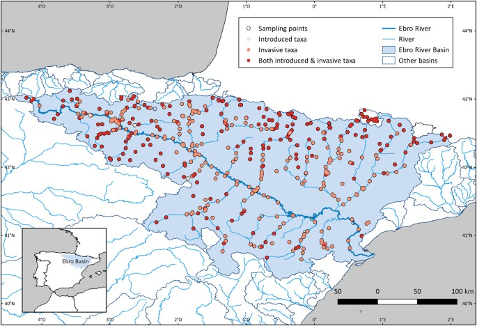
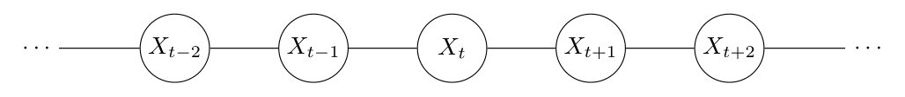
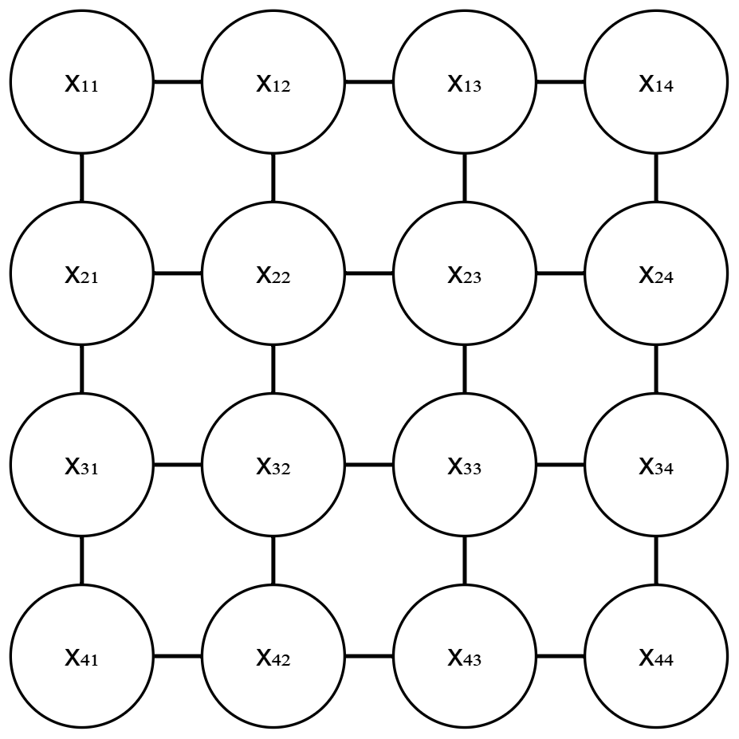
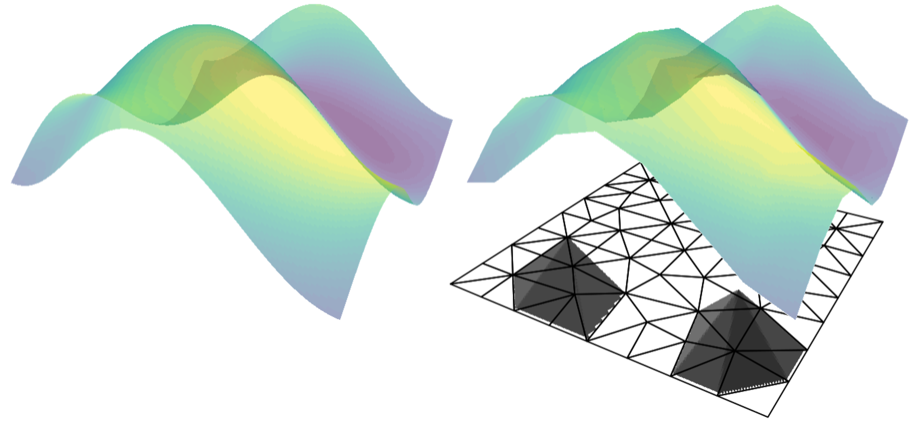
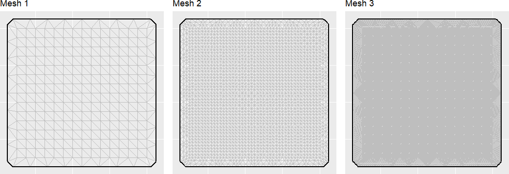
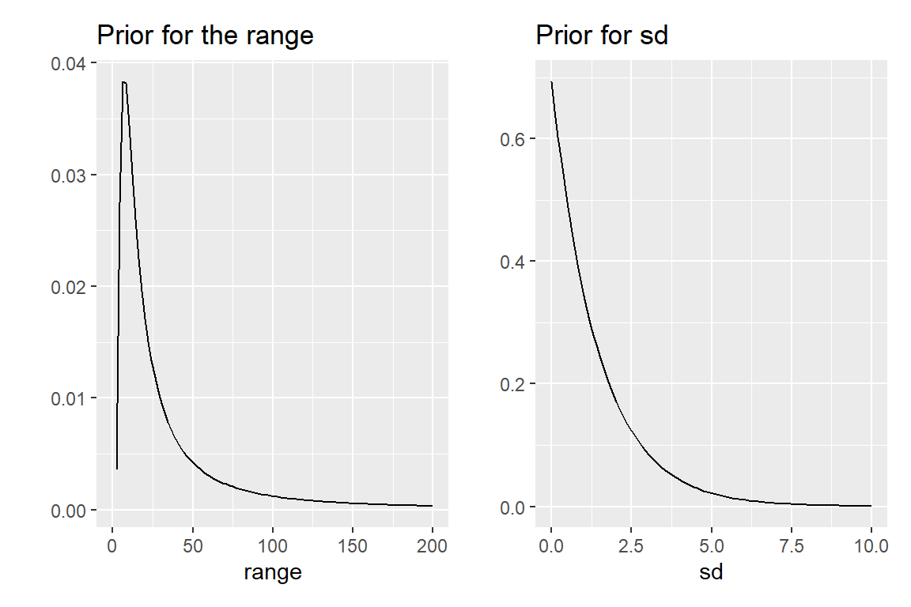

```{r setup}
# #| include: false

knitr::opts_chunk$set(echo = FALSE,
                      message=FALSE,
                      warning=FALSE,
                      strip.white=TRUE,
                      prompt=FALSE,
                      fig.align="center",
                       out.width = "60%")

library(knitr)    # For knitting document and include_graphics function
library(ggplot2)  # For plotting
library(png)
library(tidyverse)
library(INLA)
library(BAS)
library(patchwork)
library(inlabru)
library(fmesher)
library(sf)
library(scico)
``` 

# Geostatistical modelling {background-image="figures/geostats_img.jpg"}


## Geostatistical data 

::: {style="font-size: 0.85em;"}

In many ecological and environmental settings, measurements are taken from fixed sampling units, aiming to quantify spatial variation and interpolate values at unobserved sites.

:::::: columns
:::: {.column width="60%"}
::: incremental
-   Geostatistical data are the most common form of spatial data found in environmental and ecological settings.
-   We regularly take measurements of an environmental variable of interest at a set of fixed locations.
-   Our goal is to estimate the value of our variable across the entire space.
:::
::::

::: {.column width="40%"}
{fig-align="center" width="475"}
:::
::::::

:::


# Spatial Modelling {background-image="figures/geostats_img.jpg"}


## How do we model this? {auto-animate="true"}

Imagine we have animal counts across several sites in a region. We can model them as Poisson

$$
y_i \sim \mathrm{Poisson}(e^{\eta_i})
$$ How do we model the linear predictor $\eta_i$?

::: {.fragment .fade-in}
-   We could model the number of animals in each region independently

$$
 \eta_i = \beta_0 + \mathbf{x}'\beta + u_i ~~~ u_i \overset{iid}{\sim} N(0,\sigma^2_i)
$$

-   regional differences are accounted for through a *random effect*
:::

## How do we model this? { auto-animate="true"}

Imagine we have animal counts across several sites in a region. We can model them as Poisson

$$
y_i \sim \mathrm{Poisson}(e^{\eta_i})
$$ How do we model the linear predictor $\eta_i$?

::: {.fragment .fade-in}
-   But... what if the distribution varies across space, i.e. is structured in space?
-   Do the covariates account for those structures?
-   If there’s an area where the animal is rare, we’ll get lots of zero counts
:::

## How do we model this? { auto-animate="true"}

Imagine we have animal counts across several sites in a region. We can model them as Poisson

$$
y_i \sim \mathrm{Poisson}(e^{\eta_i})
$$ How do we model the linear predictor $\eta_i$?

::: {.fragment .fade-in}
-   We could model some dependence across regions:
    -   *Nearby regions* should have similar counts

$$
\eta_i = \beta_0 + \mathbf{x}'\beta + u_i ~~~ \mathbf{u} \sim N(0,\Sigma)
$$

-   Now the random effect $u_i \sim N(0, \Sigma)$ is correlated.
:::

::: {.fragment .fade-in}
-   How do we do this?
:::

## Sparse Matrixes {auto-animate=true}

$$
\mathcal{u}\sim\mathcal{N}(0,\Sigma)
$$

1.  Force the *covariance* matrix $\Sigma$ to be sparse

2.  Force the *precision* matrix $\Sigma^{-1}$ to be sparse

## Sparse Matrixes {auto-animate=true}

$$
\mathcal{u}\sim\mathcal{N}(0,\Sigma)
$$

1.  Force the *covariance* matrix $\Sigma$ to be sparse

    -   $\Sigma_{ij} = \text{Cov}(u_i, u_j)$ : Covariance between $u_i$ and $u_j$
    -   $\Sigma_{ij} = 0$ $\longrightarrow$ $u_i$ and $u_j$ are *independent*
    -   A sparse covariance matrix implies that many elements of $\mathbf{u}$ are mutually independent.....is this desirable?

2.  Force the *precision* matrix $\mathbf{Q} = \Sigma^{-1}$ to be sparse

## Sparse Matrixes {auto-animate=true}

$$
\mathcal{u}\sim\mathcal{N}(0,\Sigma)
$$

1.  Force the *covariance* matrix $\Sigma$ to be sparse

    -   $\Sigma_{ij} = \text{Cov}(u_i, u_j)$ : Covariance between $u_i$ and $u_j$
    -   $\Sigma_{ij} = 0$ $\longrightarrow$ $u_i$ and $u_j$ are *independent*
    -   A sparse covariance matrix implies that many elements of $\mathbf{u}$ are mutually independent.....is this desirable?

2.  Force the *precision* matrix $\mathbf{Q} = \Sigma^{-1}$ to be sparse

    -   What does $Q_{ij}$ represents?
    -   What does a sparse precision matrix implies?


# Gaussian Markov Random Fields  {background-image="figures/areal_img.jpg"}


## The AR(1) process

**Definition**

$$
\begin{aligned}
\mathbf{i=1}&:  x_1 \sim N\left(0, \frac{1}{1-\phi^2}\right)\\
\mathbf{i=2,\dots,T}&:  x_i  = \phi\  x_{i-1} +\epsilon_i,\ \epsilon_i\sim\mathcal{N}(0,1)
\end{aligned}
$$


-   Every year is correlated with every other year...
-   ...but each year depends **directly** only on the years either side of it
-   Once you know those two, the other years add no extra information
-   How do covariance and precision matrices look?

## Covariance and Precision Matrix for AR1 {auto-animate="true" background-color="#FFFFFF"}

::: {style="height: 50px;"}
:::

::::: columns
::: {.column .smaller width="50%"}
**Covariance Matrix**


::::: {style="font-size: 0.7em;"}
$$
\Sigma = \frac{1}{1-\phi^2}  \begin{bmatrix}
1& \phi & \phi^2  & \dots& \phi^N \\
\phi & 1& \phi  & \dots& \phi^{N-1} \\
\phi^2 & \phi & 1 & \dots& \phi^{N-2} \\
\dots& \dots& \dots& \dots& \dots& \\
\phi^{N} & \phi^{N-1}& \phi^{N-2}  & \dots& 1\\
\end{bmatrix}
$$
:::::

-   This is a *dense* matrix.

-   All elements of the $\mathbf{x}$ vector are *dependent*.
:::

::: {.column width="50%"}
```{r, echo = F, eval = T}
#| fig-width: 8
#| fig-height: 8
phi = 0.8
x = 0:15
cx = (1-phi^2)^(-1)*phi^x

data.frame(lag = x, cov = cx) %>%
  ggplot() + geom_point(aes(lag, cov)) +
  ggtitle(expression("Covariance between "~u[i]~u[i+h])) +
  xlab("h") + ylab("") + ylim(0,(1-phi^2)^(-1)) +
   theme(title = element_text(size = 18),
        axis.text.x = element_text(size = 16),
        axis.text.y = element_text(size = 16))
```
:::
:::::

## Covariance and Precision Matrix for AR1 {.smaller auto-animate="true"}

::: {style="height: 50px;"}
:::

**Precision Matrix**

$$
\mathbf{Q} = \Sigma^{-1} =  \begin{bmatrix}
1& -\phi & 0  & 0 &\dots& 0 \\
-\phi & 1 + \phi^2& -\phi  & 0 & \dots& 0 \\
0 & -\phi & 1 +\phi^2 &-\phi &  \dots& 0 \\
0 & 0 & -\phi &1 + \phi^2 & \dots & \dots \\
\dots& \dots& \dots& \dots& \dots& \dots& \\
0 &0 & 0 & \dots  & -\phi& 1\\
\end{bmatrix}
$$

-   This is a tridiagonal matrix, it is *sparse*

-   The tridiagonal form of $\mathbf{Q}$ can be exploited for quick calculations.

. . .

What is the key property of this example that causes $\mathbf{Q}$ to be sparse?


## Conditional independence {background-color="#FFFFFF"}

::::: {style="font-size: 0.85em;"}
The key lies in the **full conditionals**

$$
x_t|\mathbf{x}_{-t}\sim\mathcal{N}\left(\frac{\phi}{1+\phi^2}(x_{t-1}+x_{t+1}), \frac{1}{1+\phi^2}\right)
$$

::: fragment
{fig-align="center" width="709"}

:::{.incremental}
-   The circles represent the values of $x$ at individual time points

-   There is a line between them if they are conditionally dependent

-   Each timepoint is only **conditionally dependent** on the two closest neighbours

-   The nonzero pattern in the precision matrix is given by the neighborhood structure of the process
:::

:::
:::::

## Conditional autoregressive models {.smaller background-color="#FFFFFF"}

:::::: columns
::: {.column width="50%"}
**Markov in Space:**

First order conditional autoregressive model or a CAR(1) model.

-   Every node is conditionally dependent on its four nearest neighbours

{fig-align="center" width="293"}
:::

:::: {.column width="50%"}
::: incremental
-   Models based on neighbourhood have a name in statistics: they are **Markovian models**

-   Markovian models are specified entirely through "*neighbourhood structures*"

-   Recall our first Model:

    $$
    \begin{aligned}
    y_i &\sim \mathrm{Poisson}(e^{\eta_i}) \\
    \eta_i &= \beta_0 + \mathbf{x}'\beta + u_i ~~~ u_i \sim N(0,Q^{-1})
    \end{aligned}
    $$

-   This mean $u_i$ is independent of all the other parameters $\mathbf{u}_{-i}$, given the set of its neighbors.

-   for any pair of elements ($i,j$) in $\mathbf{u}$, $u_i\perp u_j|\mathbf{u}_{-ij}\Longleftrightarrow Q{ij} =0$

-   $Q{ij} \neq 0$ only if $j\in \{i,\mathcal{N}(i)\}$
:::
::::
::::::

## GMRFs in a nutshell

A **Gaussian Markov random field** is a Gaussian random effect whose dependence is defined by a neighbourhood graph.

-   Neighbours give a sparse precision matrix $\mathbf{Q}$
-   A sparse $\mathbf{Q}$ makes computation fast, which is what INLA exploits
-   Natural for time (AR1, random walks) and for areal data (CAR, BYM)

. . .

**Geostatistical data** (points in continuous space) have no natural neighbours.

We instead **approximate** the continuous surface of interest via a GMRF defined on a triangular mesh over our region, so we get the same speed in a continuous space.

## What We Observed and What We Did Not


::: {style="font-size: 0.85em;"}

We treat the observed process of interest as being measured with error

$$
(\text{observed value})_i = (\text{true value at location } i) + (\text{error})_i
$$

equivalent to

$$
y_i = Z(\mathbf{s}_i) + \varepsilon_i
$$

When geostatistical data are considered, we can often assume that there is a spatially continuous variable underlying the observations that can be modeled using a **random field**.

::: incremental
-   we have a process that is occurring everywhere in space $\rightarrow$ natural to try to model it using some sort of function (of space)

-   a **random field** is a random function that generates smooth surfaces

-   This is hard

-   We typically make our lives easier by making everything Gaussian
:::

:::

## Gaussian Random Fields {.smaller auto-animate="true"}

A **Gaussian random field** (GRF) is a collection of random variables, where observations occur in a continuous domain, and where every finite collection of random variables has a multivariate normal distribution

$$
\mathbf{z} = (z(\mathbf{s}_1),\ldots,z(\mathbf{s}_m)) \sim N(\mu(\mathbf{s}_1),\ldots,\mu(\mathbf{s}_m),\Sigma),
$$

where $\Sigma_{ij} = \mathrm{Cov}(z(\mathbf{s}_i),z(\mathbf{s}_j))$ is a dense $m \times m$ matrix.

::: incremental
-   This is actually quite tricky: $\Sigma$ will need to depend on the set of observation sites and has to behave well (be "*positive definite*")
-   Use a covariance function $C_z(\cdot,\cdot)$ that depends on the distance ($\Sigma_{ij} = C_z(\mathbf{s}_i,\mathbf{s}_j)$) between two points and that
    -   has no negative variances
    -   is symmetric
    -   is decreasing, with maximum at distance = 0
-   $C_z(\mathbf{s}_i, \mathbf{s}_j)$ measures the strength of the linear dependence between $Z(\mathbf{s}_i)$ and $Z(\mathbf{s}_j)$.
-   $C_z(\mathbf{s}_i, \mathbf{s}_j) = \mathrm{Var}(Z(\mathbf{s}_i))$ for $i = j$.
:::

## Stationary and isotropy 

::: {style="font-size: 0.85em;"}

We will assume our *Gaussian process* can be described as weakly stationary if the following criteria are met:

$E[{Z(\mathbf{s})}] = \mu_z(\mathbf{s}) = \mu_z$ - a finite constant which does not depend on $\mathbf{s}$.

$\text{Cov}(Z(\mathbf{s}_i),Z(\mathbf{s}_j)) = C_z(\mathbf{s}_i-\mathbf{s}_j)$ - a finite constant which can depend on distance $(\mathbf{s}_i-\mathbf{s}_j)$.

:::{.incremental}
-   Condition 1 states that our mean function must be constant in space, with no overall spatial trend.

-   Condition 2 states that for any two locations, their covariance depends only on how far apart they are (their spatial lag, $h$), not their absolute position.
:::

:::{.fragment}
Our process is said to be **isotropic** if the covariance function is directionally invariant. This means that the covariance only depends on the euclidean distance $(||\mathbf{s}_i-\mathbf{s}_j||)$ and not the direction.
:::

:::

## Building the model 


::: {style="font-size: 0.85em;"}

The first step in defining a model for a random field in a hierarchical framework is to identify a probability distribution for the observations available at $m$ sampled spatial locations and represented by the vector $\mathbf{y} = y_1,\ldots,y_m$.

For example, if we assume our observations follow a Gaussian distribution then

$$
\begin{aligned}
Y_i &\sim N(\mu_i,\tau_e^{-1})\\
\eta_i &=\mu_i = \beta_0 + \ldots + Z(\mathbf{s}_i)
\end{aligned}
$$

:::{.incremental}
-   $\tau_e^{-1} = \sigma^2_e$ represents the variance of the zero-mean measurement error

-   The response mean $\mu_i$ which coincides with the linear predictor $\eta_i$ is defined based on:

    -   the intercept $\beta_0$ and any additional covariates

    -   the realization of the latent (*unobservable*) GF $Z(\mathbf{s}) \sim \mathrm{MVN}(0,\Sigma)$ which accounts for the spatial correlation through $\Sigma = C_z(\cdot,\cdot)$.
    
:::

:::

## The Matérn Field

::: {style="font-size: 0.85em;"}
A commonly used covariance function is the Matérn covariance function. The covariance of two points which are a distance $h$ apart is:

$$
    \Sigma =C_{\nu}(h) = \sigma^2 \frac{2^{1-\nu}}{\Gamma(\nu)} \left( \frac{\sqrt{2\nu} h}{\rho} \right)^{\nu} K_{\nu} \left( \frac{\sqrt{2\nu} h}{\rho} \right)
$$

-   $\Gamma(\cdot)$ is the gamma function

-   $K_{\nu}(\cdot)$ is the modified Bessel function of the second kind.

-   Parameters $\sigma^2$, $\rho$ and $\nu$ are non-negative values of the covariance function.

    -   $\sigma^2$ is the *spatially structured* variance component

    -   $\rho$ is the range of the spatial process

    -   $\nu$ controls smoothness of the spatial process.
    
:::

## The SPDE approach

The Matérn $\Sigma$ is still dense, so we are back to the *big n* problem: the cost grows like $n^3$.

a different approach to GRF models:

:::{.incremental}
-  forget about the covariance function!

-  express spatial structure through an SPDE (stochastic partial differential equation):

    -  a simple differential equation describes change in time

    -  a partial differential equation describes change in space (in more than 1 direction!)

    -  a stochastic partial differential equation makes this random,i.e. not deterministic
    
-  need to approximate spatial structures in a clever way.
:::

# The SPDE approach {background-image="figures/INLADiagram.png"}

## The  stochastic partial differential equation

We define a (Matérn) GRF as the solution of a stochastic partial differential equation (SPDE)

$$
(\kappa^2-\Delta)^{\alpha/2}Z(s) = W(\mathbf{s})
$$


-   $W(\mathbf{s})$ is random noise
-   $Z(\mathbf{s})$ is the smooth process we want
-   $(\kappa^2-\Delta)^{\alpha/2}$ is an operator that "smooths" the white noise.
-   $\kappa$ and $\alpha$ are parameters


## Example: the SPDE approach in 1D {.smaller background-color="#FFFFFF"}

:::::: columns
:::: {.column width="40%"}
Imagine a guitar string stretched from left to right.

-   Now imagine someone randomly taps along it at many locations:

    ::: incremental
    -   Each tap is independent
    -   Some taps are strong, some weak
    -   There is no coordination between taps
    -   A tap at one location tells you nothing about a tap nearby
    :::

::: fragment
*This is pure randomness.* But a real string does not behave like this
:::
::::

::: {.column width="60%"}
```{r}
#| echo: false
#| fig-width: 10
#| fig-height: 10

set.seed(2026)
# ----- Parameters -----
N      <- 650        # number of grid points
x_min  <- 0
x_max  <- 10
x      <- seq(x_min, x_max, length.out = N)
h      <- x[2] - x[1]   # grid spacing

W <- rnorm(N, mean = 0, sd = 1)  # white noise on the grid

p1 = data.frame(x =x,
           W = W)

ggplot(p1,aes(x=x,y=W))+geom_line(col="grey60")+geom_hline(yintercept = 0) + coord_cartesian(ylim = c(-1, 1)) + labs(x="t")

```
:::
::::::

::: notes
No smoothness

Sharp up/down jumps

No gentle waves

No continuity in behavior

That's because nothing connects one tap to the next.
:::

##  SPDE as a smoothing operator {.smaller auto-animate="true" background-color="#FFFFFF"}

:::::: columns
:::: {.column width="40%"}
Imagine a guitar string stretched from left to right.

-   The rope has tension and stiffness
    -   the tension spreads each tap to nearby points
    -   Sharp jumps are softened. $(\kappa^2-\Delta)^{\color{red}{\alpha}/2}\omega(t) = W(t)$

::: fragment
-   $\Delta$ measures the local curvature
-   $\kappa$ controls how far randomness propagates
-   stronger tension (large $\kappa$) = stronger pull

$$(\color{red}{\kappa^2}-\Delta)\omega(t) = W(t), ~~~\text{for } \alpha=2$$
:::
::::

::: {.column width="60%"}
```{r}
#| echo: false
#| fig-width: 10
#| fig-height: 10

set.seed(2026)
N      <- 650        # number of grid points
x_min  <- 0
x_max  <- 10
x      <- seq(x_min, x_max, length.out = N)
h      <- x[2] - x[1]   # grid spacing

# SPDE parameters to try
kappa_vals <- c(0.5, 1.0, 2.0)   # smaller kappa -> longer range (looser rope)
alpha_vals <- c(2, 4)            # alpha = 2 (one smoothing), alpha = 4 (smoother)

# ----- Build 1D second-difference matrix D2 -----
# D2 * u approx = u_{i-1} - 2 u_i + u_{i+1}
D2 <- matrix(0, nrow = N, ncol = N)
diag(D2) <- -2
for(i in 1:(N-1)){
  D2[i, i+1] <- 1
  D2[i+1, i] <- 1
}
# (Neumann-like) boundary handling: keep D2[1,1] = -1? We'll keep simple Dirichlet-style here:
# (current code uses the simple interior stencil and leaves boundaries with fewer neighbors)

I_N <- diag(1, N)

# ----- Helper: build discrete operator A = (kappa^2 I - d2/dx2) -----
build_A <- function(kappa) {
  # discrete second derivative is D2 / h^2
  A <- (kappa^2) * I_N - (D2 / (h^2))
  # small regularization for numeric stability (optional)
  A <- A + 1e-10 * I_N
  return(A)
}

# ----- Helper: solve (A^m) u = W  for integer m >= 1 (alpha = 2*m) -----
solve_alpha <- function(A, W, m = 1) {
  # Solve A^m u = W by sequential solves: A v_1 = W, A v_2 = v_1, ..., u = v_m
  v <- W
  for(j in 1:m) {
    v <- solve(A, v)
  }
  return(v)
}

# ----- Generate one white-noise realization -----
W <- rnorm(N, mean = 0, sd = 1)  # white noise on the grid

# alpha=2m

u_fix1 <- solve_alpha(build_A(0.5), W, m = 2)  # alpha=2 -> m=1
u_fix2 <- solve_alpha(build_A(1), W, m = 2)  # alpha=2 -> m=1
u_fix3 <- solve_alpha(build_A(2), W, m = 2)  # alpha=2 -> m=1

p1 = data.frame(x =x,
           W = W,
           u1  = u_fix1,
           u2  = u_fix2,
           u3  = u_fix3
           ) %>%
  ggplot() + geom_line(aes(x,W), alpha = 0.2) + geom_line(aes(x,u1, color = "k = 0.5")) +
  geom_line(aes(x,u2, color = "k = 1")) +
  geom_line(aes(x,u3, color = "k = 2")) + xlab("") + ylab("") + ggtitle("alpha = 2") + coord_cartesian(ylim = c(-1, 1))+scale_color_discrete(name="") +
  theme(
    legend.text  = element_text(size = 18),   # label text size
    legend.key.size = unit(2, "cm"),         # size of the colour swatches
    legend.title = element_text(size = 18)     # title (empty here, but sets size if you add one)
  )

p1 + labs(x="t")

```
:::
::::::

::: notes
Measure the bending at $\omega_i$ by taking the with respect the average of the neighbours (i.e. $\omega_i - (\omega_{i-1}+\omega_i/2) = \omega_{i-1} + 2\omega_i +z_{i+1}$).

-   if $= 0 \rightarrow$ straight

-   if the diff is large $\rightarrow$ sharply bent

-   the sign tells you which way it bends

The curvature need to divide by the spacing $h$ between points (assuming equal spacing), i.e., $(z_{i-1} + 2z_i +z_{i+1}) \times h^{-2}$.

In a continuous space we measured this by taking the second derivative, i.e. the Laplacian operator

As $h\to 0$ we measure the rate of change of slope, i.e. curvature as:

$$(\omega_{i-1} + 2\omega_i +\omega_{i+1}) \times h^{-2}  \to \frac{\partial \omega}{\partial t^2} = \Delta \omega$$ Where $\omega(x)$ is the displacement of the string at position $t$.

Tension ($\kappa$): resists large displacement If a tap pushes part of the string far up or down:

-   tension pulls it back
-   stronger tension = stronger pull

$$
\begin{aligned}
(\color{red}{\kappa^2}-\Delta)\omega(t) &= W(t) \\
\color{red}{\kappa^2}\omega(t) - \Delta \omega(t) &= W(t)\\
\text{if } \omega(t) \text{ is large then }& \color{tomato}{\kappa^2 \omega(t)} \text{ becomes large too} \\
\text{large pull}-\text{back bending}&=\text{random tap}
\end{aligned}
$$ In this case, To balance the equation, $\omega(t)$ must be smaller.
:::

##  SPDE as a smoothing operator {.smaller auto-animate="true" background-color="#FFFFFF"}

:::::: columns
:::: {.column width="40%"}
Imagine a guitar string stretched from left to right.

-   The rope has tension and stiffness
    -   the tension spreads each tap to nearby points
    -   Sharp jumps are softened.

::: fragment
-   Stiffness = controls how smooth the field becomes ($\alpha$)
-   Larger $\alpha$ smoother the process will be

$$
(\kappa^2-\Delta)^{\color{red}{\alpha}/2}\omega(t) = W(t)
$$
:::
::::

::: {.column width="60%"}
```{r}
#| echo: false
#| fig-width: 10
#| fig-height: 10

set.seed(2026)

# Grid
N      <- 650
x_min  <- 0
x_max  <- 10
x      <- seq(x_min, x_max, length.out = N)
h      <- x[2] - x[1]

# Build D2
D2 <- matrix(0, nrow = N, ncol = N)
diag(D2) <- -2
for(i in 1:(N-1)){
  D2[i, i+1] <- 1
  D2[i+1, i] <- 1
}
I_N <- diag(1, N)

# White noise
W <- rnorm(N, mean = 0, sd = 1)

# Fix kappa
kappa_fixed <- 0.5

# alpha = 2  -> m = 1
u_alpha2 <- solve_alpha(build_A(kappa_fixed), W, m = 1)

# alpha = 4  -> m = 2
u_alpha4 <- solve_alpha(build_A(kappa_fixed), W, m = 2)

# Plot
library(ggplot2)
library(dplyr)

df <- data.frame(
  x = x,
  W = W,
  alpha2 = u_alpha2,
  alpha4 = u_alpha4
)

p <- df %>%
  ggplot() +
  geom_line(aes(x, W), alpha = 0.2) +
  geom_line(aes(x, alpha2, color = "alpha = 2")) +
  geom_line(aes(x, alpha4, color = "alpha = 4")) +
  labs(
    x = "t",
    y = "W"
  ) +
  coord_cartesian(ylim = c(-1, 1)) +
  scale_color_discrete(name = "")+
  theme(
    legend.text  = element_text(size = 18),   # label text size
    legend.key.size = unit(2, "cm"),         # size of the colour swatches
    legend.title = element_text(size = 18)     # title (empty here, but sets size if you add one)
  )

p


```
:::
::::::

::: notes
Lastly $\alpha$ controls how *smooth* the final shape. E.g.,

$$
W(t) = \begin{cases}
(\kappa^2-\Delta)\omega(t) & \text{if } \alpha= 2 \text{ i.e., string resists curvature once}\\
(\kappa^2-\Delta)^2\omega(t) & \text{if } \alpha= 4 \text{ i.e., string resists curvature twice}
\end{cases}
$$

Take the white noise $W(t)$ and smooth it once by the operator $(\kappa^2 - \Delta)^{-1}$ so the operator filters the white noise once

-   it reduces sharp spikes

-   but still leaves some visible bumps

At $\alpha=2$ we smooth the result again.. Each pass removes high-frequency components (sharp bumps)
:::

## Solving the SPDE {.smaller background-color="#FFFFFF" auto-animate="true"}

Ok...but we still need to solve the SPDE to find $\omega(t)$!

. . .

Now we need to discretize the domain into T points (we cannot compute on the continuous!)

. . .

::::: columns
::: {.column width="50%"}
We represent our solution as

$$
\omega(t) = \sum_{i = 1}^T\psi_i(t)w_i
$$

Where

-   $\psi_i(t)$ are (known) basis functions for nodes $i=1,\ldots,T$

    -   $\psi_i(t_i)= 1$

    <!-- -->

    -   $\psi_i(t_j) = 0 ~~\forall~~i \neq j$

    <!-- -->

    -   Linear between neighboring nodes
:::

::: {.column width="50%"}
```{r}
#| out-width: 70%

locs = c(-5,10,15,25,40,50,60)
mesh1d = fm_mesh_1d(locs, degree = 1, boundary = "neumann")
p1 = ggplot() +
  geom_fm(data = mesh1d, xlim = c(-10, 70)) +
  geom_point(data = data.frame(x = locs, y = 0), aes(x,y)) +
  geom_text(data = data.frame(x = locs + 0.5, y = -0.1), aes(x,y,label = 1:7))

p1

eval = fm_evaluator(mesh1d)
w = round(runif(7), 3)

 p1 + geom_line(data = data.frame(x = eval$x,
                           y = fm_evaluate(eval, w)),
                aes(x,y), size = 2) + ggtitle(paste("w=",paste(round(w,2), collapse = ', ')))

```
:::
:::::

::: notes
-   "solving the SPDE" means Find a random function $\omega(t)$ such that the equality $(\kappa^2-\Delta)^{\alpha/2}Z\omega(t) = W(t)$ holds in distribution.
-   in other words find $\omega(s)$ such that when the operator $(\kappa^2-\Delta)^{\alpha/2}$ is applied to it, it produces white noise
-   OR, The Matérn field is the Gaussian field $\omega(s)$ produced by smoothing white noise $W(t)$ through the inverse operator $(\kappa^2-\Delta)^{\alpha/2}$.
-   The Matérn field is infinite-dimensional so we approximate it using a finite basis expansion
    -   we want a simple local basis
    -   each basis only affects neighbors
    -   so computations become sparse
-   Each weight $w_i$ is basically the value of the field at node $i$
-   The basis functions are:
    -   Height = 1 at node
    -   Zero at neighboring nodes
    -   Linear in between
-   A hat function is not the field. It is a *building block* for the field.
-   the field between nodes is interpolated linearly so the vector of weights fully defines the approximate field.
-   Since the SPDE is linear and the white noise is Gaussian, the solution is Gaussian
:::

## Solving the SPDE {.smaller background-color="#FFFFFF" auto-animate="true"}

Ok...but we still need to solve the SPDE to find $\omega(t)$!

Now we need to discretize the domain into T points (we cannot compute on the continuous!)

::::: columns
::: {.column width="50%"}
We represent our solution as

$$
\omega(t) = \sum_{i = 1}^T\psi_i(t)w_i
$$

Where

-   $\psi_i(t)$ are (known) basis functions for nodes $i=1,\ldots,T$

-   $w_i$ are (unknown) weights

    -   the field value $\omega(s)$ is a **linear interpolation** between the two neighboring weights
:::

::: {.column width="50%"}
```{r}
#| out-width: 70%

locs = c(-5,10,15,25,40,50,60)
mesh1d = fm_mesh_1d(locs, degree = 1, boundary = "neumann")
p1 = ggplot() +
  geom_fm(data = mesh1d, xlim = c(-10, 70)) +
  geom_point(data = data.frame(x = locs, y = 0), aes(x,y)) +
  geom_text(data = data.frame(x = locs + 0.5, y = -0.1), aes(x,y,label = 1:7))

p1

eval = fm_evaluator(mesh1d)
w = round(runif(7), 3)

 p1 + geom_line(data = data.frame(x = eval$x,
                           y = fm_evaluate(eval, w)),
                aes(x,y), size = 2) + ggtitle(paste("w=",paste(round(w,2), collapse = ', ')))

```
:::
:::::

::: notes
-   "solving the SPDE" means Find a random function $Z(t)$ such that the equality $(\kappa^2-\Delta)^{\alpha/2}Z(t) = W(t)$ holds in distribution.
-   in other words find $Z(s)$ such that when the operator $(\kappa^2-\Delta)^{\alpha/2}$ is applied to it, it produces white noise
-   OR, The Matérn field is the Gaussian field $Z(s)$ produced by smoothing white noise $W(t)$ through the inverse operator $(\kappa^2-\Delta)^{\alpha/2}$.
-   The Matérn field is infinite-dimensional so we approximate it using a finite basis expansion
    -   we want a simple local basis
    -   each basis only affects neighbors
    -   so computations become sparse
-   Each weight $w_i$ is basically the value of the field at node $i$
-   The basis functions are:
    -   Height = 1 at node
    -   Zero at neighboring nodes
    -   Linear in between
-   A hat function is not the field. It is a *building block* for the field.
-   the field between nodes is interpolated linearly so the vector of weights fully defines the approximate field.
-   Since the SPDE is linear and the white noise is Gaussian, the solution is Gaussian
:::

## Solving the SPDE {.smaller background-color="#FFFFFF" auto-animate="true"}

Ok...but we still need to solve the SPDE to find $\omega(t)$!

Now we need to discretize the domain into T points (we cannot compute on the continuous!)

::::: columns
::: {.column width="50%"}
We represent our solution as

$$
\omega(t) = \sum_{i = 1}^T\psi_i(t)w_i
$$

Where

-   $\psi_i(t)$ are (known) basis functions for nodes $i=1,\ldots,T$

-   $w_i$ are (unknown) weights

-   This solution is then approximated using a finite combination of piece-wise linear basis functions.

-   The solution is completely defined by a Gaussian vector of weights with zero mean and a sparse precision matrix.
:::

::: {.column width="50%"}
```{r}
#| out-width: 70%

locs = c(-5,10,15,25,40,50,60)
mesh1d = fm_mesh_1d(locs, degree = 1, boundary = "neumann")
p1 = ggplot() +
  geom_fm(data = mesh1d, xlim = c(-10, 70)) +
  geom_point(data = data.frame(x = locs, y = 0), aes(x,y)) +
  geom_text(data = data.frame(x = locs + 0.5, y = -0.1), aes(x,y,label = 1:7))

p1

eval = fm_evaluator(mesh1d)
w = round(runif(7), 3)

 p1 + geom_line(data = data.frame(x = eval$x,
                           y = fm_evaluate(eval, w)),
                aes(x,y), size = 2) + ggtitle(paste("w=",paste(round(w,2), collapse = ', ')))

```
:::
:::::


## The SPDE approach in 2D {.smaller auto-animate="true"}

The SPDE is the same, but now the field is indexed by location $\mathbf{s}=(s_1,s_2)$:

$$(\kappa^2-\Delta)^{\alpha/2}\, Z(\mathbf{s}) = W(\mathbf{s})$$

::: fragment
Now we approximate the GRF using a triangulated mesh:

-   We construct an appropriate lower-resolution approximation of the surface by sampling it at a set of well designed points and constructing a piece-wise linear interpolant.
:::

::: fragment
The SPDE approach represents the continuous spatial process as a continuously indexed Gaussian Markov Random Field (GMRF)
:::

{fig-align="center" width="520"}


## The SPDE approach in 2D {.smaller auto-animate="true"}


Define a projector matrix $A$ that maps the field from the **mesh nodes** onto the data **locations**


<iframe src="mesht2obs.html" width="100%" height="560" style="border: none;"></iframe>


::: notes
-   The mesh has 16 nodes;$\mathbf{s}= s_1,s_2,s_3,s_4$ are observation locations.
-   Each node $i$ has a basis function $\psi_i(s)$  that takes the value of 1 at node $i$, 0 at every other node and flat on each triangle.
-   At a the location $s_j$ only three basis functions are non-zero: those of the corners of the triangle containing $s_j$. Their heights at  $s_j$ are the interpolation weights which sum to 1.
-   So "the height of the basis where the point lies" becomes "the value of basis function $\psi_i$ at $s_j$,
-   The weight of each corner (edge) is the area of the sub-triangle opposite it, divided by the area of the triangle
-   Stacking these weights for all observations gives the projector matrix $A$ that maps the mesh to the observations
-   The field is $Z(s_j) = \sum_i \psi_i(s_j) w_i$, the sum of the product between the basis evaluated at $s_j$ and the values of field at node $i$ (there $\psi_i = 1$ and all other basis functions are 0); between nodes, Z is a linear interpolation of the $w_i$.
-   The node values are unknown and get a Gaussian prior, $\mathbf{w} \sim N(\mathbf{0}, \mathbf{Q}^{-1})$. 
:::


## The precision matrix $\mathbf{Q}$ {.smaller background-color="#FFFFFF"}


:::::: columns
:::: {.column width="60%"}

::: {style="font-size: 0.86em;"}

The solution of the SPDE is approximated by @lindgren2010explicit as:

$$
\begin{aligned}
Z(s) &= \sum_{i = 1}^K\psi_i(s)w_i \\
\mathbf{w} &\sim N(\mathbf{0},Q^{-1}) \leftarrow \text{GMRF}\\
\end{aligned}
$$


-   FEM builds $\mathbf{Q}$ from two mesh matrices:

$$
Q = \kappa^4 \mathbf{C} + 2\kappa^2 \mathbf{G}+\mathbf{G}\mathbf{C}^{-1}\mathbf{G})
$$


:::{.incremental}
-   $C_{ij} = \langle\psi_i,\psi_j\rangle$:  measures how much of the domain each basis function covers.
-   $G_{ij}=\int\nabla\psi_i\cdot\nabla\psi_j\,d\mathbf{s}$: non-zero only if $i$ and $j$ share an edge and reflects the connectivity of the mesh nodes.
-   because each basis function overlaps only with nearby ones, the resulting precision matrix is sparse.
:::

:::

:::: 

:::: {.column width="40%"}


<iframe src="precision-Q-vertical.html" width="100%" height="560" style="border: none;"></iframe>

:::: 
:::::: 


## In summary {.smaller}

-   The continuous Matérn GRF is the solution of a SPDE and is represented as

$$
Z(s) = \sum_{i = 1}^K\psi_i(s)w_i
$$

-   The weights vector $\mathbf{w} = (w_1,\dots,w_K)$ is GMRF with a **sparse** precision matrix $\longrightarrow$ Computational convenience

-   The field has two parameters

    -   The range $\rho$
    -   The marginal variance $\sigma^2$

-   These parameters are linked to the parameters of the SPDE

-   We need to assign prior to them

## Penalized Complexity (PC) priors

Penalized Complexity (PC) priors proposed by Simpson et al. ([2017](https://projecteuclid.org/journals/statistical-science/volume-32/issue-1/Penalising-Model-Component-Complexity--A-Principled-Practical-Approach-to/10.1214/16-STS576.full)) allow us to control the amount of spatial smoothing and avoid overfitting.

-   PC priors shrink the model towards a simpler baseline unless the data provide strong evidence for a more complex structure.
-   To define the prior for the marginal precision $\sigma^{-2}$ and the range parameter $\rho$, we use the probability statements:
    -   Define the prior for the range $\text{Prob}(\rho<\rho_0) = p_{\rho}$
    -   Define the prior for the range $\text{Prob}(\sigma>\sigma_0) = p_{\sigma}$

new ukvi ## Learning about the SPDE approach {.smaller}

::: {style="height: 50px;"}
:::

-   D. Miller, R.  Glennie, R. and A. Seaton. (2020). Understanding the Stochastic Partial Differential Equation Approach to Smoothing. *Journal of Agricultural, Biological and Environmental Statistics*, 25(1), 1-16.

-   F. Lindgren, H. Rue, and J. Lindström. An explicit link between Gaussian fields and Gaussian Markov random fields: The SPDE approach (with discussion). In: *Journal of the Royal Statistical Society, Series B* 73.4 (2011), pp. 423–498.

-   H. Bakka, H. Rue, G. A. Fuglstad, A. Riebler, D. Bolin, J. Illian, E. Krainski, D. Simpson, and F. Lindgren. Spatial modelling with R-INLA: A review. In: *WIREs Computational Statistics* 10:e1443.6 (2018). (Invited extended review). DOI: 10.1002/wics.1443.

-   E. T. Krainski, V. Gómez-Rubio, H. Bakka, A. Lenzi, D. Castro-Camilio, D. Simpson, F. Lindgren, and H. Rue. *Advanced Spatial Modeling with Stochastic Partial Differential Equations using R and INLA*. Github version \url{www.r-inla.org/spde-book}. CRC press, Dec. 20


# Modelling Pacific Cod Distribution {background-image="figures/cod.jpg"}

## Modelling Pacific Cod Distribution 


In the next example, we will explore data on the Pacific Cod (*Gadus macrocephalus*) from a trawl survey in Queen Charlotte Sound.

-   The dataset contains the presence/absence of Pacific cod in the area swept for a given survey in 2003 as well as depth covariate information.

```{r}
#| echo: false
#| message: false
#| eval: true
#| out-width: 100%

library(sdmTMB)

pcod_df = sdmTMB::pcod %>% filter(year==2003)
qcs_grid = sdmTMB::qcs_grid
pcod_sf =   st_as_sf(pcod_df, coords = c("lon","lat"), crs = 4326)
pcod_sf = st_transform(pcod_sf,
                       crs = "+proj=utm +zone=9 +datum=WGS84 +no_defs +type=crs +units=km" )
library(terra)
depth_r <- rast(qcs_grid, type = "xyz")
crs(depth_r) <- crs(pcod_sf)
library(tidyterra)
ggplot()+ 
  geom_spatraster(data=depth_r$depth)+
      geom_sf(data=pcod_sf,aes(color=factor(present))) +
    scale_color_manual(name="Locations where Pacific Cod \nwere caught",
                     values = c("black","orange"),
                     labels= c("Absence","Presence"))+
  scale_fill_scico(name = "Depth",
                   palette = "nuuk",
                   na.value = "transparent" ) + xlab("") + ylab("")
par(mfrow=c(1,1))
```


## The Model {background-color="#FFFFFF" auto-animate="true"}

-   **Stage 1** Model for the response $$
    y(s)|\eta(s)\sim\text{Binomial}(p(s))
    $$

-   **Stage 2** Latent field model $$
    \eta(s) = \mathrm{logit}(p(s)) = \beta_0 + \beta_1 \,\log \text{depth}(s)+ Z(s)
    $$

-   **Stage 3** Hyperparameters

## The Model {background-color="#FFFFFF" auto-animate="true"}

-   **Stage 1** Model for the response $$
    y(s)|\eta(s)\sim\text{Binomial}(p(s))
    $$

-   **Stage 2** Latent field model $$
    \eta(s) = \mathrm{logit}(p(s)) = \beta_0 +\beta_1 \,\log \text{depth}(s) + Z(s)
    $$

    -   A global intercept $\beta_0$
    -   A covariate effect $\beta_1$
    -   A Gaussian field $Z(s)$

-   **Stage 3** Hyperparameters

## The Model {background-color="#FFFFFF" auto-animate="true"}

-   **Stage 1** Model for the response $$
    y(s)|\eta(s)\sim\text{Binomial}(p(s))
    $$

-   **Stage 2** Latent field model $$
    \eta(s) = \mathrm{logit}(p(s)) = \beta_0 + \beta_1 \,\log \text{depth}(s) + Z(s)
    $$

-   **Stage 3** Hyperparameters

    -   Range and sd in the Gaussian field $\sigma_{\omega}, \tau_{\omega}$


## Step 1: Define the SPDE representation: The mesh

First, we need to create the mesh used to approximate the random field.

```{r}
library(fmesher)
mesh = fm_mesh_2d(loc = pcod_sf,           # Build the mesh
                  cutoff = 2,
                  max.edge = c(7,20),     # The largest allowed triangle edge length.
                  offset = c(5,50))       # The automatic extension distance

```

```{r}
#| echo: false
ggplot() + gg(mesh) +
  geom_sf(data= pcod_sf, aes(color = factor(present))) + 
  xlab("") + ylab("")
```

-   `max.edge` for maximum triangle edge lengths
-   `offset` for inner and outer extensions (to prevent *edge effects*)
-   `cutoff` to avoid overly small triangles in clustered areas

## Step 1: Define the SPDE representation: The mesh

::: incremental
-   All random field models need to be discretised for practical calculations.

-   The SPDE models were developed to provide a consistent model definition across a range of discretisations.

-   We use finite element methods with local, piecewise linear basis functions defined on a triangulation of a region of space containing the domain of interest.

-   Deviation from stationarity is generated near the boundary of the region.

-   The choice of region and choice of triangulation affects the numerical accuracy.
:::

## Step 1: Define the SPDE representation: The mesh {background-color="#FFFFFF"}

-   If the mesh is too fine $\rightarrow$ heavy computation

-   If the mesh is to coarse $\rightarrow$ not accurate enough

{fig-align="center"}

## Step 1: Define the SPDE representation: The mesh

**Some guidelines**

-   Create triangulation meshes with `fm_mesh_2d()`:

-   edge length should be around a third to a tenth of the spatial range

-   Move undesired boundary effects away from the domain of interest by extending to a smooth external boundary:

-   Use a coarser resolution in the extension to reduce computational cost (`max.edge=c(inner, outer)`), i.e., add extra, larger triangles around the border

## Step 1: Define the SPDE representation: The mesh

-   Use a fine resolution (subject to available computational resources) for the domain of interest (inner correlation range) and avoid small edges ,i.e., filter out small input point clusters (0 $<$ \`cutoff $<$ inner)

-   Coastlines and similar can be added to the domain specification in `fm_mesh_2d()` through the `boundary` argument.

-   simplify the border

## Step 1: Define the SPDE representation: The SPDE {.smaller}

We use the `inla.spde2.pcmatern` to define the SPDE model using PC priors through the following probability statements


:::: {.columns}

::: {.column width="40%"}

```{r}
spde_model =  inla.spde2.pcmatern(mesh,
                                  prior.sigma = c(1, 0.5),
                                  prior.range = c(100, 0.5))
```

:::

::: {.column width="60%"}

-   $P(\rho < 100) = 0.5$

-   $P(\sigma > 1) = 0.5$

:::

::::

{fig-align="center" width="425"}


## Step 2: Define the model components {.smaller auto-animate="true"}

::::: columns
::: {.column width="55%"}
**The Model**

$$
\begin{aligned}
y(s)|\eta(s) & \sim\text{Binom}(1, p(s))\\
\eta(s) &  = \color{#FF6B6B}{\boxed{\beta_0}} + \color{#FF6B6B}{\boxed{  \beta_1 \,\log \text{depth}(s) }} + \color{#FF6B6B}{\boxed{ Z(s)}}\\
\end{aligned}
$$

:::{.fragment}
-  `depth` is a column in our `sf` data
-  `geometry` column allow us to use spatial objects as input
:::

:::

::: {.column width="45%"}
```{r}
#| echo: true
pcod_sf %>% select(depth, present) %>% print(n = 3)
```
:::


:::::

**The code**

```{r}
#| echo: true
#| eval: true
#| warning: false
#| message: false
#| code-line-numbers: "1-3"

# define model component
cmp = ~ -1 + Intercept(1) +  depth_eff(log(depth), model='linear') + 
  space(geometry, model = spde_model)

# define model predictor
eta = present ~ Intercept + depth_eff + space

# build the observation model
lik = bru_obs(formula = eta,
              data = pcod_sf,
              family = "binomial")

# fit the model
fit = bru(cmp, lik)
```


## Step 2: Define the model components {.smaller auto-animate="true"}


::::: columns
::: {.column width="55%"}
**The Model**
$$
\begin{aligned}
y(s)|\eta(s) & \sim\text{Binom}(1, p(s))\\
\eta(s) &  = \beta_0 + \beta_1 \,\log \color{#FF6B6B}{\boxed{\text{depth}(s) } } +  Z(s)\\
\end{aligned}
$$
:::

::: {.column width="45%"}
- here `depth_r` is a raster and `depth` a layer (be careful with NA's).
-  `.data.` is a keyword referring to whatever data object is passed to `bru_obs()` or `bru()`
-  `eval_spatial()` extracts the value of the spatial covariate at the locations in the data
:::
:::::

::: {style="margin-top: -2.5em;"}
**Spatial covariates**
:::

:::: columns
::: {.column width="50%"}
```r
~ my_sp_effect(
  main = a_spatial_object,
  model = "linear"
)
```
:::

::: {.column width="50%"}
```r
~ my_sp_effect(
  main = eval_spatial(a_spatial_object, .data.),
  model = "linear"
)
```
:::
::::

**The code**

```{r}
#| echo: true
#| eval: false
#| warning: false
#| message: false
#| code-line-numbers: "1-3"

# define model component
cmp = ~ -1 + Intercept(1) +  depth_eff(log(depth_r$depth), model='linear') + 
  space(geometry, model = spde_model)

# define model predictor
eta = present ~ Intercept + depth_eff + space

# build the observation model
lik = bru_obs(formula = eta,
              data = pcod_sf,
              family = "binomial")

# fit the model
fit = bru(cmp, lik)
```


## Step 3: Define the linear predictor {.smaller auto-animate="true"}

::::: columns
::: {.column width="55%"}
**The Model**
$$
\begin{aligned}
y(s)|\eta(s) & \sim\text{Binom}(1, p(s))\\
\color{#FF6B6B}{\boxed{\eta(s)}} &  = \color{#FF6B6B}{\boxed{\beta_0 +  \beta_1 \,\log \text{depth}(s) +  Z(s)}}\\
\end{aligned}
$$
:::

::: {.column width="45%"}
```{r}
#| echo: true
pcod_sf %>% select(depth, present) %>% print(n = 3)
```
:::
:::::

**The code**

```{r}
#| echo: true
#| eval: false
#| warning: false
#| message: false
#| code-line-numbers: "5-6"

# define model component
cmp = ~ -1 + Intercept(1) +  depth_eff(log(depth), model='linear') + 
  space(geometry, model = spde_model)

# define model predictor
eta = present ~ Intercept + depth_eff + space

# build the observation model
lik = bru_obs(formula = eta,
              data = pcod_sf,
              family = "binomial")

# fit the model
fit = bru(cmp, lik)
```

## Step 4: Define the observational model {.smaller auto-animate="true"}

::::: columns
::: {.column width="55%"}
**The Model**

$$
\begin{aligned}
\color{#FF6B6B}{\boxed{y(s)|\eta(s)}} & \sim \color{#FF6B6B}{\boxed{\text{Binom}(1, p(s))}}\\
\eta(s) &  = \beta_0 +  \beta_1 \,\log \text{depth}(s) +  Z(s)\\
\end{aligned}
$$

:::

::: {.column width="45%"}
```{r}
#| echo: true
pcod_sf %>% select(depth, present) %>% print(n = 3)
```
:::
:::::

**The code**

```{r}
#| echo: true
#| eval: false
#| warning: false
#| message: false
#| code-line-numbers: "8-11|13-14"

# define model component
cmp = ~ -1 + Intercept(1) +  depth_eff(log(depth), model='linear') + 
  space(geometry, model = spde_model)

# define model predictor
eta = present ~ Intercept + depth_eff + space

# build the observation model
lik = bru_obs(formula = eta,
              data = pcod_sf,
              family = "binomial")

# fit the model
fit = bru(cmp, lik)
```


## Step 5: Collect Results {.smaller auto-animate="true"}

We can plot the posterior density of the model components via `plot(model, "model component")` and also look at the correlation/covariance function as follows:

```{r}
#| echo: true
#| code-fold: true


Inter_post <- plot(fit, "Intercept")
depth_post <- plot(fit, "depth_eff")
corplot <- plot(spde.posterior(fit, "space", what = "matern.correlation"))
covplot <- plot(spde.posterior(fit, "space", what = "matern.covariance"))

Inter_post + depth_post + corplot + covplot + plot_layout(ncol=2)
```

# Spatial predictions {background-image="figures/geostats_img.jpg"}


## Posterior predictive density 

::: {style="font-size: 0.6em;"}
The key lies in the **posterior predictive distribution**

$$
  \pi(\tilde{Y} \mid y)
  = \int \pi(\tilde{Y} \mid \Theta, y)\, \pi(\Theta \mid y)\, d\Theta,
$$ 

where $\Theta$ denotes *all* latent components and hyperparameters.

:::{.incremnetal}

-   $\pi(\tilde{Y} \mid \Theta, y)$ depends on the task:
    -   extrapolation(e.g. forecasting): $\pi(Y_{n+1} \mid \Theta, y_n)$,
    -   **interpolation**: $\pi(Y_i \mid y_{i-1}, y_{i+1}, \Theta)$,
-   Spatial prediction fits naturally into this framework:
    -   $\tilde{Y}$ may represent $Z(s_0)$, $\eta_0$, or the response at $y(s_0)$,
    -   conditioning reflects the assumed spatial dependence.
-   INLA approximates $\pi(\Theta \mid y)$ efficiently, enabling **full uncertainty propagation** when predicting over $s_0 \in \mathcal{D}$.

:::

:::


## Posterior predictive density { .smaller auto-animate="true" background-color="#FFFFFF"}

::::: columns
::: {.column width="40%"}

1. Define a grid of points where we want to predict. `fm_pixel()` creates a regular grid of points covering the mesh (*we will see in the practical how your the raster can be used instead*)


:::

::: {.column width="60%"}

```{r}
#| echo: true
#| code-line-numbers: "1"
pxl = fm_pixels(mesh) #<1>

# 2. extract raster values at the point locations
vals <- terra::extract(depth_r$depth, pxl, ID = FALSE)

# 3. bind the extracted values onto the sf object
pred_data <- cbind(pxl, vals) %>%  filter(!is.na(depth))


preds = predict(fit, pred_data, 
      ~data.frame(spde = space,
                  eta = Intercept + 
                        depth_eff +
                        space,
                  p_s = plogis(Intercept + 
                               depth_eff +
                               space)))


```

:::

:::::


:::{.notes}
-   A projector matrix $A$ linking the latent Gaussian field to the prediction locations.

-   This ensures that the spatial effects and covariates at new locations are properly included in the model.

-   Linear predictors are computed at these new locations
:::


## Posterior predictive density { .smaller auto-animate="true" background-color="#FFFFFF"}

::::: columns
::: {.column width="40%"}

1. Define a grid of points where we want to predict. `fm_pixel()` creates a regular grid of points covering the mesh (*we will see in the practical how your the raster can be used instead*)

2. Append the values of the covariate(s) (if any) at the prediction locations

:::

::: {.column width="60%"}

```{r}
#| echo: true
#| code-line-numbers: "3-7"
pxl = fm_pixels(mesh) #<1>

# 2. extract raster values at the point locations
vals <- terra::extract(depth_r$depth, pxl, ID = FALSE) #<2>

# 3. bind the extracted values onto the sf object
pred_data <- cbind(pxl, vals) %>%  filter(!is.na(depth)) 


preds = predict(fit, pred_data, 
      ~data.frame(spde = space,
                  eta = Intercept + 
                        depth_eff +
                        space,
                  p_s = plogis(Intercept + 
                               depth_eff +
                               space)))


```

:::

:::::


## Posterior predictive density { .smaller auto-animate="true" background-color="#FFFFFF"}

::::: columns
::: {.column width="40%"}

1. Define a grid of points where we want to predict. `fm_pixel()` creates a regular grid of points covering the mesh (*we will see in the practical how your the raster can be used instead*)

2. Append the values of the covariate(s) (if any) at the prediction locations

3. `inlabru` will create a projector matrix $A$ linking the latent Gaussian field to the prediction locations via the `predict` function.


:::

::: {.column width="60%"}

```{r}
#| echo: true
#| code-line-numbers: "10"
pxl = fm_pixels(mesh) #<1>

# 2. extract raster values at the point locations
vals <- terra::extract(depth_r$depth, pxl, ID = FALSE)

# 3. bind the extracted values onto the sf object
pred_data <- cbind(pxl, vals) %>%  filter(!is.na(depth))


preds = predict(fit, pred_data, #<3> 
      ~data.frame(spde = space,
                  eta = Intercept + 
                        depth_eff +
                        space,
                  p_s = plogis(Intercept + 
                               depth_eff +
                               space)))


```

:::

:::::


## Posterior predictive density { .smaller auto-animate="true" background-color="#FFFFFF"}

::::: columns
::: {.column width="40%"}

1. Define a grid of points where we want to predict. `fm_pixel()` creates a regular grid of points covering the mesh (*we will see in the practical how your the raster can be used instead*)

2. Append the values of the covariate(s) (if any) at the prediction locations

3. `inlabru` will create a projector matrix $A$ linking the latent Gaussian field to the prediction locations via the `predict` function.

4. We can do predictions for $Z(s)$,$\eta(s)$, $g^{-1}(\eta(s))$


:::

::: {.column width="60%"}

```{r}
#| echo: true
#| code-line-numbers: "11-17"
pxl = fm_pixels(mesh) #<1>

# 2. extract raster values at the point locations
vals <- terra::extract(depth_r$depth, pxl, ID = FALSE)

# 3. bind the extracted values onto the sf object
pred_data <- cbind(pxl, vals) %>%  filter(!is.na(depth))


preds = predict(fit, pred_data, #<3> 
      ~data.frame(spde = space, #<4>
                  eta = Intercept + 
                        depth_eff +
                        space,
                  p_s = plogis(Intercept + 
                               depth_eff +
                               space)))


```

:::

:::::


## Posterior predictive density {.smaller auto-animate="true" background-color="#FFFFFF"}

Outputs include posterior means, variances, and credible intervals.


```{r}
#| echo: true
#| output-location: column-fragment
#| fig-height: 15
#| fig-width: 10

spde_pred <- ggplot() +
   gg(preds$spde, aes(fill = q0.5),
      geom = "tile") + 
   scale_fill_scico(name= "median SPDE" ) 

eta_pred <- ggplot() +
   gg(preds$eta, aes(fill = sd),
      geom = "tile") + 
   scale_fill_scico(name=expression(eta~"sd"),
                    palette = "lapaz") 

p_pred <- ggplot() +
   gg(preds$p_s, aes(fill = mean),
      geom = "tile") + 
   scale_fill_scico(palette = "roma") 

spde_pred +  eta_pred + p_pred + plot_layout(ncol=1)

```


## Take-Home Message

-  Gaussian random fields provide components that reflect spatial structure in continuous space

-   the SPDE approach allows us to approximate these efficiently and flexibly

-   the models are still GMRFs ⇝ computationally efficient representation

-   pc-priors are also relevant for spatial models, e.g. to avoid overfitting


