```{r setup}
# #| include: false

knitr::opts_chunk$set(echo = TRUE,
                      message=FALSE,
                      warning=FALSE,
                      strip.white=TRUE,
                      prompt=FALSE,
                      fig.align="center",
                       out.width = "60%")

library(knitr)    # For knitting document and include_graphics function
library(ggplot2)  # For plotting
library(png)
library(tidyverse)
library(INLA)
library(BAS)
library(patchwork)
library(inlabru)
library(fmesher)
library(sf)
library(scico)
library(gt)
``` 
# Spatial point processes {background-image="figures/spp_img.png"}


## Point process data

Many of the ecological and environmental processes of interest can be represented by a spatial point process or can be viewed as an aggregation of one.

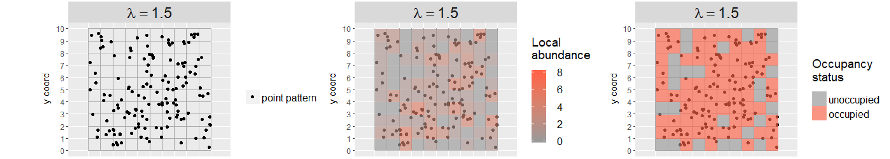{fig-align="center" width="600"}

-   Many contemporary data sources collect georeferenced information about the location where an event has occur (e.g., species occurrence, wildfire, flood events).
-   This point-based information provides valuable insights into ecosystem dynamics.

## Point patterns vs. geostatistical data

:::::: columns
::: {.column width="50%"}
**Point patterns:**

-  Data format: x,y coordinates
-  Optional: marks
-  Aim: model locations as random
:::
::: {.column width="50%"}
**Geostatistical data:**

-  Data format: x,y coordinates
-  Measurements mandatory
-  Aim: model continuous process at fixed locations
:::

:::::: 

:::{.fragment}
**models of spatial patterns**: modelling locations and properties (*"marks"*) of objects, events, individuals in space and time

**aim**: understanding mechanisms that generated the pattern
:::


## Defining a Point Process 

::: {style="font-size: 0.85em;"}
::: incremental
-   Consider a fixed geographical region $A$.

-   The set of locations at which events occur are denoted by $\mathbf{s} = (\mathbf{s}_1, \ldots, \mathbf{s}_n)$.

-   We let $N(A)$ be a random variable which represents the total number of events in every subset of region $A$.

-   Our primary interest is in measuring where events occur, so the **locations are our data**.

-   Let $\lambda$ the *intensity* or *point density*, i.e, the mean number of points per unit area

-   In some cases, the intensity will be constant over space (homogeneous), while in other cases it can vary by location (inhomogeneous).

-   If our intensity is homogeneous, we can define it as

    $$
    \lambda(s) = \frac{\mathbb{E}[N(A)]}{|A|} = \frac{\lambda |A|}{|A|} = \lambda.
    $$
:::
:::


## Complete spatial randomness {.smaller}

We can use the concept of intensity to help us define **complete spatial randomness (CSR)**.

-   For any spatial region $A$, CSR requires that:

::: incremental
1.  *Uniformity and Independent scattering* : Given the number of events $N(A) = n$ in a region, the $n$ events are independently and have an equal probability of occurring anywhere in the study area.

2.  *Poisson distribution of point counts*: The number of points in any set $A_i$ follows a Poisson distribution with mean $\lambda|A_i|$, that is $$N(A_i) \sim \text{Poisson}(\lambda \,|A_i|).$$
:::

<!--  1. **Independent scattering**: The number of points in $k$ disjoint sets are independent of each other. -->

::: fragment
-   If these conditions are satisfied, we can describe our process as a **homogeneous Poisson process**.
:::

::: notes
-   CSR describes a point pattern that is "completely random".

-   conditional on the number of points $N(A) = n$, the $n$ points are independently and uniformly distributed over $A$ i.e., each event has an equal probability of occurring anywhere in the study areaNOT that the Point form an uniform spatial patter

-   Thus, a realization of a HPP is a PP described by CSR.
:::

## Homogeneous Poisson Process {.smaller background-color="#FFFFFF"}

::: {style="height: 50px;"}
:::

:::{.incremental}
-   A simplest point process model is the homogeneous Poisson process (HPP).

-   The likelihood of a point pattern $\mathbf{y} = \left[ \mathbf{s}_1, \ldots, \mathbf{s}_n \right]^\intercal$ distributed as a HPP with intensity $\lambda$ and observation window $\Omega$ is

    $$
    p(\mathbf{y} | \lambda) \propto \lambda^n e^{ \left( - |\Omega| \lambda \right)} ,
    $$

    -   $|\Omega|$ is the size of the observation window.

    -   $\lambda$ is the expected number of points per unit area.

    -   $|\Omega|\lambda$ the total expected number of points in the observation window.

:::

::: {style="height: 50px;"}
:::

:::{.fragment}
-   A key property of a Poisson process is that the number of points within any subset $A_i$ of region $A$ is Poisson distributed with constant rate $|A_i|\lambda$.
:::

## Inhomogeneous Poisson process {.smaller auto-animate="true"}

Let $\mathbf{y} = s_1,\ldots,s_n$ the $n$ number of observed events/points in an observation window $\Omega$

For an IPP with an intensity $\lambda(s)$, the likelihood is given by:

$$
p(\mathbf{y} | \lambda) \propto \exp \left( -\int_\Omega \lambda(\mathbf{s}) \mathrm{d}\mathbf{s} \right) \prod_{i=1}^n \lambda(\mathbf{s}_i).
$$

::: incremental
-   If the case of an **HPP** the integral in the likelihood can easily be computed as $\int_\Omega \lambda(\mathbf{s}) \mathrm{d}\mathbf{s} =|\Omega|\lambda$

-   For an **HPP** with an intensity $\lambda$, the log-likelihood is given by: $$
    l(\beta;\mathbf{y}) = n\log(\lambda) -\lambda|\Omega|,
    $$

-   The maximum likelihood estimators is $\hat{\lambda} = n/|\Omega|$.

-   For **IPP**, the integral in the likelihood has to be approximateda as a weighted sum.

$$\int_\Omega \lambda(\mathbf{s}) \mathrm{d}\mathbf{s} \approx \sum_{j=1}^J w_j \lambda(\mathbf{s}_j)$$


:::


## Limitations with IPP

::: {style="height: 50px;"}
:::

::: incremental
-   IPP models assume that data points are conditionally independent given the covariates, meaning that any spatial variation is fully explained by environmental and sampling factors.
-   Unmeasured endogenous and exogenous factors can create spatial dependence.
-   Ignoring them can lead to bias in our conclusions.
:::

## The Log-Gaussian Cox Process {.smaller}

::: {style="height: 50px;"}
:::

-   Log-Gaussian Cox processes (LGCP) extend the IPP by allowing the intensity function to vary spatially according to a structured spatial random effect, i.e. the intensity is random

$$
\log~\lambda(s)= \mathbf{x}(s)'\beta + \xi(s)
$$

-   The events are then assumed to be independent given the covariates and $\xi(s)$ - a GRF with Matérn covariance.

::: fragment
How do we model $\xi(s)$ ?
:::

::: fragment

:::{.incremental}
-   We use an SPDE model!
-   The software `inlabru` has implemented some integration schemes that are especially well suited to integrating the intensity in models with an SPDE effect (location of point are not approximated!).
-   By default, `inlabru` uses the same points to define the SPDE approximation and to approximate the integral in the likelihood (mesh nodes), but this can be changed.
:::

:::

::: aside
See for further reference: Simpson, Daniel, Janine B. Illian, Finn Lindgren, Sigrunn H. Sørbye, and Håvard Rue. 2016. "Going off grid: computationally efficient inference for log-Gaussian Cox processes." *Biometrika* 103 (1): 49–70.
:::

# Example: Forest fires {background-image="figures/wildfire.jpg"}

## Example: Forest fires in Castilla-La Mancha {.smaller}

-   In this example we model the location of forest fires in the Castilla-La Mancha region of Spain between 1998 and 2007.

-   We are now going to use the elevation as a covariate to explain the variability of the intensity $\lambda(s)$ over the domain of interest and a spatially structured SPDE model.

$$
\log\lambda(s) = \beta_0 + \beta_1 \text{elevation}(s) + \xi(s)
$$

```{r}
#| fig-align: center
#| fig-width: 6
#| fig-height: 6
#| message: false
#| warning: false
#| echo: false

library(spatstat)
library(tidyverse)
library(terra)
library(sf)
library(ggplot2)
library(tidyterra)
data("clmfires")
pp = st_as_sf(as.data.frame(clmfires) %>%
                mutate(x = x, 
                       y = y),
              coords = c("x","y"),
              crs = NA) %>%
  filter(cause == "lightning",
         year(date) == 2004)

poly = as.data.frame(clmfires$window$bdry[[1]]) %>%
  mutate(ID = 1)

region = poly %>% 
  st_as_sf(coords = c("x", "y"), crs = NA) %>% 
  dplyr::group_by(ID) %>% 
  summarise(geometry = st_combine(geometry)) %>%
  st_cast("POLYGON") 
  
elev_raster = rast(clmfires.extra[[2]]$elevation)
elev_raster = scale(elev_raster)


```


:::::: columns
::: {.column width="50%"}
```{r}
#| fig-align: center
#| fig-width: 6
#| fig-height: 6
#| message: false
#| warning: false
#| echo: false

ggplot() + geom_spatraster(data = elev_raster) +  geom_sf(data = region, col = "black", alpha = 0,linewidth =0.75) + geom_sf(data = pp) + scale_fill_scico(name= "Elevation")
```
:::

::: {.column width="50%"}
 
```{r}
pp  %>% print(n = 6)
```
:::
:::::: 


<!-- ## Example: Forest fires in Castilla-La Mancha {.smaller background-color="#FFFFFF"} -->

<!-- :::::: columns -->
<!-- ::: {.column width="50%"} -->
<!-- **The IPP Model**  -->
<!-- $$ -->
<!-- \begin{aligned} -->
<!-- p(\mathbf{y} | \lambda)  & \propto \exp \left( -\int_\Omega \lambda(\mathbf{s}) \mathrm{d}\mathbf{s} \right) \prod_{i=1}^n \lambda(\mathbf{s}_i) \\ -->
<!-- \eta(s) &  = \log ~\lambda(s) = \beta_0 +  \beta_1 \,x(s) -->
<!-- \end{aligned} -->
<!-- $$ **The code** -->

<!-- ```{r} -->
<!-- #| echo: true -->
<!-- #| eval: false -->
<!-- #| warning: false -->
<!-- #| message: false -->

<!-- # define model component -->
<!-- cmp = ~ Intercept(1) + elev(elev_raster, model = "linear") -->

<!-- # define model predictor -->
<!-- eta  = geometry ~ Intercept +  elev -->

<!-- # build the observation model -->
<!-- lik = bru_obs("cp", -->
<!--               formula = eta, -->
<!--               data = pp, -->
<!--               ips = ips) -->

<!-- # fit the model -->
<!-- fit = bru(cmp, lik) -->

<!-- ``` -->
<!-- ::: -->

<!-- :::: {.column width="50%"} -->
<!-- ::: panel-tabset -->
<!-- ## Regular Grid -->

<!-- ```{r} -->
<!-- #| echo: true -->
<!-- n.int = 1000 -->
<!-- ips <- st_sample(region, size = n.int, type = "regular") # May not be exactly n.int points -->
<!-- ips <- new_fm_int( -->
<!--   ips, -->
<!--   weight = st_area(region) / length(ips), -->
<!--   name = "geometry" -->
<!-- ) -->


<!-- ``` -->

<!-- ```{r} -->
<!-- #| echo: false -->
<!-- #| fig-width: 5 -->
<!-- #| fig-height: 5 -->
<!-- ggplot() + geom_sf(data = ips, aes(color = weight)) + geom_sf(data= region, alpha = 0) -->
<!-- ``` -->

<!-- ## `fm_int` -->

<!-- ```{r} -->
<!-- #| echo: true -->

<!-- # The mesh -->
<!-- mesh = fm_mesh_2d(boundary = region, -->
<!--                   max.edge = c(5, 10), -->
<!--                   cutoff = 4, crs = NA) -->

<!-- # build integration scheme -->
<!-- ips = fm_int(mesh, -->
<!--              samplers = region) -->

<!-- ``` -->

<!-- ```{r} -->
<!-- #| echo: false -->
<!-- #| fig-width: 5 -->
<!-- #| fig-height: 5 -->


<!-- ggplot() + geom_sf(data = ips, aes(color = weight),size=0.5) + -->
<!--    scale_color_scico(palette = "roma") + gg(mesh) -->


<!-- ``` -->
<!-- ::: -->
<!-- :::: -->
<!-- :::::: -->

## Example: Forest fires in Castilla-La Mancha {.smaller background-color="#FFFFFF"}

::::: columns
::: {.column width="50%"}
**The LGCP Model**

$$
\begin{aligned}
p(\mathbf{y} | \lambda)  & \propto \exp \left( -\int_\Omega \lambda(\mathbf{s}) \mathrm{d}\mathbf{s} \right) \prod_{i=1}^n \lambda(\mathbf{s}_i) \\
\eta(s) &  = \log(\lambda(s)) = \color{#FF6B6B}{\boxed{\beta_0}} + \color{#FF6B6B}{\boxed{ x(s)}} + \color{#FF6B6B}{\boxed{ \omega(s)}}\\
\end{aligned}
$$

**The code**

```{r}
#| echo: true
#| eval: false
#| warning: false
#| message: false
#| code-line-numbers: "1-3"

# define model component
cmp = ~ Intercept(1) + elev(elev_raster, model = "linear") +
  space(geometry, model = spde_model)


# define model predictor
eta  = geometry ~ Intercept +  elev + space


# build the observation model
lik = bru_obs("cp",
              formula = eta,
              data = pp,
              ips = ips)


# fit the model
fit = bru(cmp, lik)

```
:::

::: {.column width="50%"}
```{r}
#| echo: true

# The mesh
mesh = fm_mesh_2d(boundary = region,
                  max.edge = c(5, 10),
                  cutoff = 4, crs = NA)

# The SPDE model
spde_model =  inla.spde2.pcmatern(mesh,
                                  prior.sigma = c(1, 0.5),
                                  prior.range = c(100, 0.5))

# build integration scheme
ips = fm_int(mesh,
             samplers = region)

```

```{r}
#| echo: false
#| fig-width: 6
#| fig-height: 6


ggplot() + geom_sf(data = ips, aes(color = weight),size=0.5) +
   scale_color_scico(palette = "roma") + gg(mesh)


```
:::
:::::

## Example: Forest fires in Castilla-La Mancha {.smaller background-color="#FFFFFF"}

::::: columns
::: {.column width="50%"}
**The LGCP Model**

$$
\begin{aligned}
p(\mathbf{y} | \lambda)  & \propto \exp \left( -\int_\Omega \lambda(\mathbf{s}) \mathrm{d}\mathbf{s} \right) \prod_{i=1}^n \lambda(\mathbf{s}_i) \\
\color{#FF6B6B}{\boxed{\eta(s)}} &  = \log(\lambda(s)) = \color{#FF6B6B}{\boxed{\beta_0 +  x(s) + \omega(s)}}\\
\end{aligned}
$$

**The code**

```{r}
#| echo: true
#| eval: false
#| warning: false
#| message: false
#| code-line-numbers: "6-7"

# define model component
cmp = ~ Intercept(1) + elev(elev_raster, model = "linear") +
  space(geometry, model = spde_model)


# define model predictor
eta  = geometry ~ Intercept +  elev + space


# build the observation model
lik = bru_obs("cp",
              formula = eta,
              data = pp,
              ips = ips)


# fit the model
fit = bru(cmp, lik)

```
:::

::: {.column width="50%"}
```{r}
#| echo: true

# The mesh
mesh = fm_mesh_2d(boundary = region,
                  max.edge = c(5, 10),
                  cutoff = 4, crs = NA)

# The SPDE model
spde_model =  inla.spde2.pcmatern(mesh,
                                  prior.sigma = c(1, 0.5),
                                  prior.range = c(100, 0.5))

# build integration scheme
ips = fm_int(mesh,
             samplers = region)

```

```{r}
#| echo: false
#| fig-width: 6
#| fig-height: 6


ggplot() + geom_sf(data = ips, aes(color = weight),size=0.5) +
   scale_color_scico(palette = "roma") + gg(mesh)


```
:::
:::::

## Example: Forest fires in Castilla-La Mancha {.smaller background-color="#FFFFFF"}

::::: columns
::: {.column width="50%"}
**The LGCP Model**

$$
\begin{aligned}
\color{#FF6B6B}{\boxed{p(\mathbf{y} | \lambda)}}  & \propto \exp \left( -\int_\Omega \lambda(\mathbf{s}) \mathrm{d}\mathbf{s} \right) \prod_{i=1}^n \lambda(\mathbf{s}_i) \\
\eta(s) &  = \log(\lambda(s)) = \beta_0 +  x(s) + \omega(s)\\
\end{aligned}
$$

**The code**

```{r}
#| echo: true
#| eval: false
#| warning: false
#| message: false
#| code-line-numbers: "10-14"

# define model component
cmp = ~ Intercept(1) + elev(elev_raster, model = "linear") +
  space(geometry, model = spde_model)


# define model predictor
eta  = geometry ~ Intercept +  elev + space


# build the observation model
lik = bru_obs("cp",
              formula = eta,
              data = pp,
              ips = ips)


# fit the model
fit = bru(cmp, lik)

```
:::

::: {.column width="50%"}
```{r}
#| echo: true

# The mesh
mesh = fm_mesh_2d(boundary = region,
                  max.edge = c(5, 10),
                  cutoff = 4, crs = NA)

# The SPDE model
spde_model =  inla.spde2.pcmatern(mesh,
                                  prior.sigma = c(1, 0.5),
                                  prior.range = c(100, 0.5))

# build integration scheme
ips = fm_int(mesh,
             samplers = region)

```

```{r}
#| echo: false
#| fig-width: 6
#| fig-height: 6


ggplot() + geom_sf(data = ips, aes(color = weight),size=0.5) +
   scale_color_scico(palette = "roma") + gg(mesh)


```
:::
:::::

## Example: Forest fires in Castilla-La Mancha {.smaller background-color="#FFFFFF"}

::::: columns
::: {.column width="50%"}
**The LGCP Model**

$$
\begin{aligned}
p(\mathbf{y} | \lambda)  & \propto \exp \left( -\int_\Omega \lambda(\mathbf{s}) \mathrm{d}\mathbf{s} \right) \prod_{i=1}^n \lambda(\mathbf{s}_i) \\
\eta(s) &  = \log(\lambda(s)) = \beta_0 +  x(s) + \omega(s)\\
\end{aligned}
$$

**The code**

```{r}
#| echo: true
#| eval: false
#| warning: false
#| message: false
#| code-line-numbers: "17-18"

# define model component
cmp = ~ Intercept(1) + elev(elev_raster, model = "linear") +
  space(geometry, model = spde_model)


# define model predictor
eta  = geometry ~ Intercept +  elev + space


# build the observation model
lik = bru_obs("cp",
              formula = eta,
              data = pp,
              ips = ips)


# fit the model
fit = bru(cmp, lik)

```
:::

::: {.column width="50%"}
```{r}
#| echo: true

# The mesh
mesh = fm_mesh_2d(boundary = region,
                  max.edge = c(5, 10),
                  cutoff = 4, crs = NA)

# The SPDE model
spde_model =  inla.spde2.pcmatern(mesh,
                                  prior.sigma = c(1, 0.5),
                                  prior.range = c(100, 0.5))

# build integration scheme
ips = fm_int(mesh,
             samplers = region)

```

```{r}
#| echo: false
#| fig-width: 6
#| fig-height: 6


ggplot() + geom_sf(data = ips, aes(color = weight),size=0.5) +
   scale_color_scico(palette = "roma") + gg(mesh)


```
:::
:::::

## Example: Forest fires in Castilla-La Mancha {.smaller background-color="#FFFFFF"}

**Model Predictions**

We can use the `predict()` method to visualize the posterior mean intensity, log-intensity, std dev, and the SPDE.

```{r}
#| echo: false
#| message: false
#| warning: false
library(viridis)

#eval_spatial(elev_raster,pp) %>% is.na() %>% any()
#eval_spatial(elev_raster,ips) %>% is.na() %>% any()
#eval_spatial(elev_raster,ips[3525,]) %>% is.na() %>% which()

# ggplot()+tidyterra::geom_spatraster(data=elev_raster)+
#   geom_sf(data=ips[3525,])

# Extend raster ext by 5 % of the original raster
re <- extend(elev_raster, ext(elev_raster)*1.05)
# Convert to an sf spatial object
re_df <- re %>% stars::st_as_stars() %>%  st_as_sf(na.rm=F)
# fill in missing values using the original raster
re_df$lyr.1 <- bru_fill_missing(elev_raster,re_df,re_df$lyr.1)
# rasterize
elev_rast_p <- stars::st_rasterize(re_df) %>% rast()
# visualize

# ggplot()+tidyterra::geom_spatraster(data=elev_rast_p)+
#   geom_sf(data=ips[3525,])


# define model component
cmp = ~ Intercept(1) + elev(elev_rast_p, model = "linear") +
  space(geometry, model = spde_model)


# define model predictor
eta  = geometry ~ Intercept +  elev + space


# build the observation model
lik = bru_obs("cp",
              formula = eta,
              data = pp,
              ips = ips)

# fit the model
fit = bru(cmp, lik)

# Predictions
elev_crop <- terra::crop(x = elev_raster,y = region,mask=TRUE)

pxl1 = data.frame(crds(elev_crop),
                  as.data.frame(elev_crop$lyr.1)) %>%
       filter(!is.na(lyr.1)) %>%
st_as_sf(coords = c("x","y")) %>%
  dplyr::select(-lyr.1)


lgcp_pred <- predict(
  fit,
  pxl1,
  ~ data.frame(
    lambda = exp(Intercept + elev + space), # intensity
    loglambda = Intercept + elev +space,  #log-intensity
    GF = space # matern field
  )
)

ggplot() +
  gg(lgcp_pred$loglambda, geom = "tile") +
  scale_fill_viridis(name=expression(log(lambda)))+
  ggplot() +
  gg(lgcp_pred$loglambda, geom = "tile",aes(fill=sd)) +
  scale_fill_viridis(name=expression(stdev-log(lambda)),option = "B")+
  ggplot() +
  gg(lgcp_pred$lambda, geom = "tile") + scale_fill_viridis(name=expression(lambda))+
  ggplot() +
  gg(lgcp_pred$GF, geom = "tile") + scico::scale_fill_scico(name="Spatial effect")+
  plot_layout(ncol=2)


```

:::{.callout-note}
Note that the mean field is, by definition, smoother than any realization of the field. Instead we can draw simulations of the filed from the posterior distribution using the `generate()` function.
:::

##  Posterior quantities {.smaller}

We can estimate the total number of events over the whole region as follows:

$$
\mathbb{E}(N_\Omega) = \int_\Omega \exp(\lambda(s)) ds
$$

To do so, we simulate possible realizations of $N_\omega$ to include also the likelihood variability in our estimate using the `generate()` method

```{r}
N_fires = generate(fit, ips,
                      formula = ~ {
                        lambda = sum(weight * exp(elev + Intercept + space))
                        rpois(1, lambda)},
                    n.samples = 2000)

```

```{r}
#| echo: false
#| fig-width: 6
#| fig-height: 6

ggplot(data = data.frame(N = as.vector(N_fires))) +
  geom_histogram(aes(x = N),
                 colour = "blue",
                 alpha = 0.5,
                 bins = 20) +
  theme_minimal() +
  xlab(expression(Lambda))

```


# Complex observation processes -- Distance Sampling {background-image="figures/DS.png"}


## Overview of Distance Sampling {.smaller background-color="#FFFFFF"}

-   Distance sampling is a family of related methods for estimating the abundance and spatial distribution of wildlife populations.

-   Distance sampling is based on the idea that animals further away from observers are harder to detect than animals that are nearer.

::::: columns
::: {.column width="40%"}
-   This idea is implemented in the model as a detection function that depends on distance.

    -   Animals at greater distances are harder to detect and the detection function therefore declines as distance increases.
:::

::: {.column width="60%"}
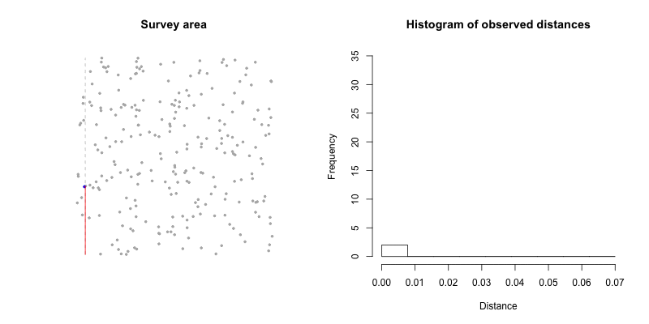{fig-align="center" width="623"}
:::
:::::


## Thinned Point Process {.smaller}

::: {style="height: 50px;"}
:::

-   flexible approach that can include spatial covariates to model the mean intensity and a spatially structured random effect to account for unexplained heterogeneity not captured by the covariates.

-   to account for the imperfect detection of points we specify a thinning probability function $$
    g(d) = \text{Prob}(\text{a point at s is detected}|\text{a point is at d(s)})
    $$

-   key property -- an LGCP with intensity $\lambda(s)$ that thinned by a probability function $g(d)$, follows also a LGCP with intensity:

$$
\underbrace{\tilde{\lambda}(s)}_{\text{observed process}} = \underbrace{\lambda(s)}_{\text{true process}} \times \underbrace{g(s)}_{\text{thinning probability}}
$$

## Thinned Point Process {.smaller auto-animate="true" background-color="#FFFFFF"}

Lets visualize this on 1D: Intensity function with [points]{style="color:grey;"}

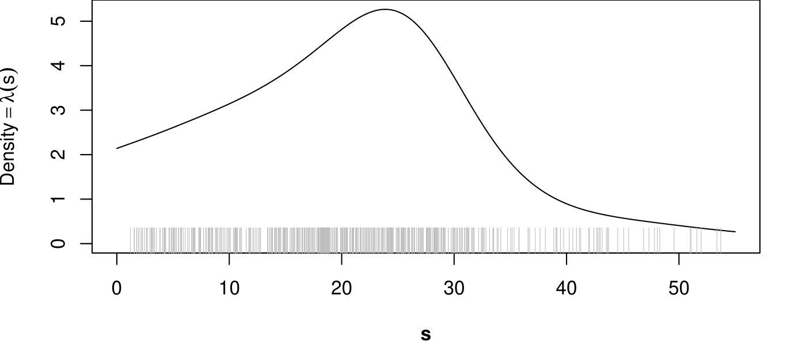{fig-align="center"}

## Thinned Point Process {.smaller auto-animate="true" background-color="#FFFFFF"}

Intensity (density) function with [points]{style="color:grey;"} and transect locations

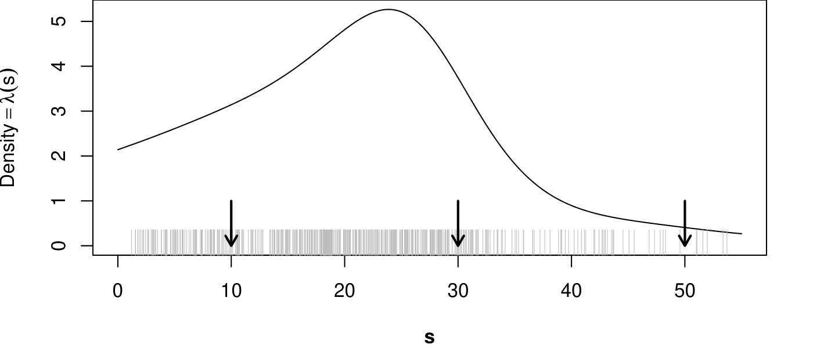{fig-align="center"}

## Thinned Point Process {.smaller auto-animate="true" background-color="#FFFFFF"}

::: incremental
-   Detection function $\color{red}{g(s)}$

-   Here $\color{red}{g(s) =1}$ on the transects (at x = 10,30 and 50).
:::

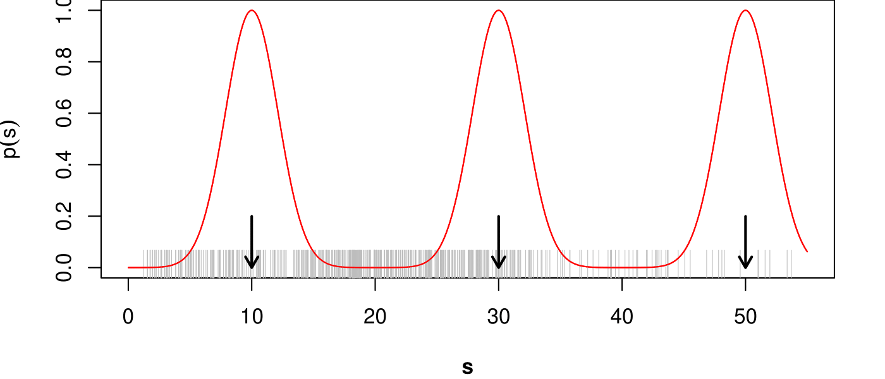{fig-align="center"}

## Thinned Point Process {.smaller auto-animate="true" background-color="#FFFFFF"}

-   Detection function $\color{red}{g(s)}$ and [detected points]{style="color:grey;"}

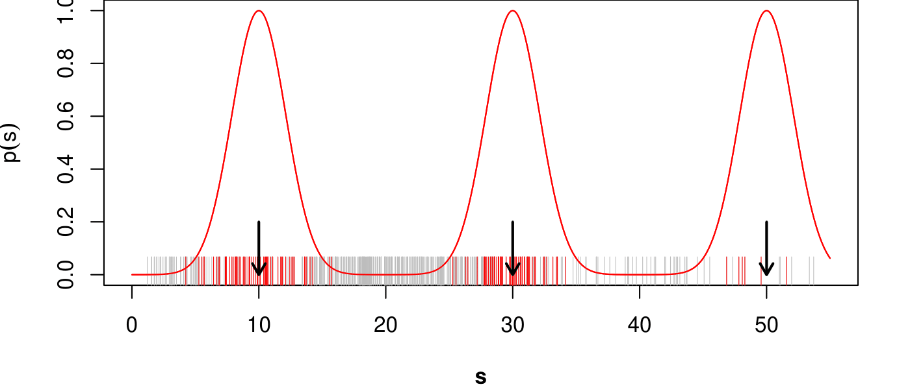{fig-align="center"}

## Thinned Point Process {.smaller auto-animate="true" background-color="#FFFFFF"}

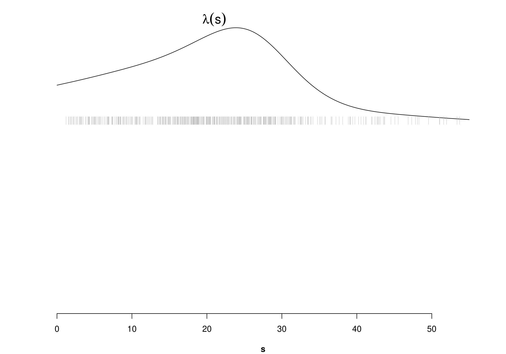{fig-align="center"}

## Thinned Point Process {.smaller auto-animate="true" background-color="#FFFFFF"}

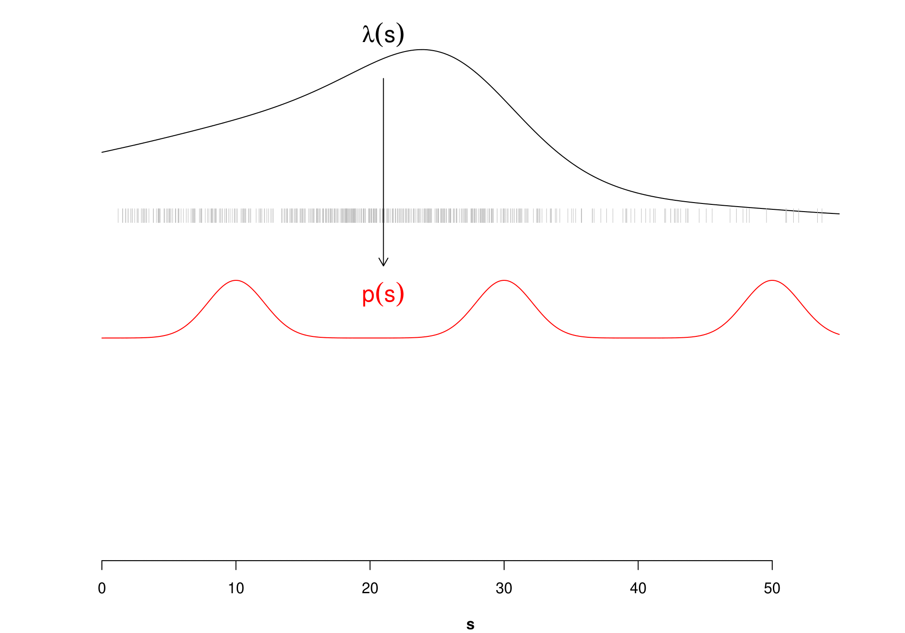{fig-align="center"} The detection function describes the probability $\color{red}{p(s)}$ that an point is detected

## Thinned Point Process {.smaller auto-animate="true" background-color="#FFFFFF"}

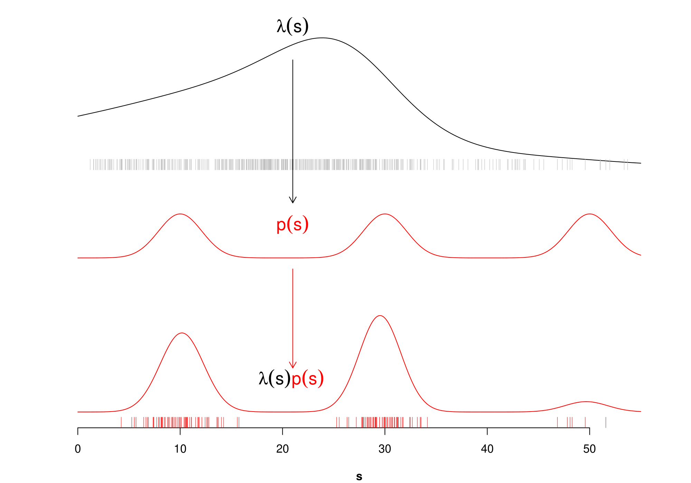{fig-align="center"}

## Thinned Point Process {.smaller auto-animate="true" background-color="#FFFFFF"}

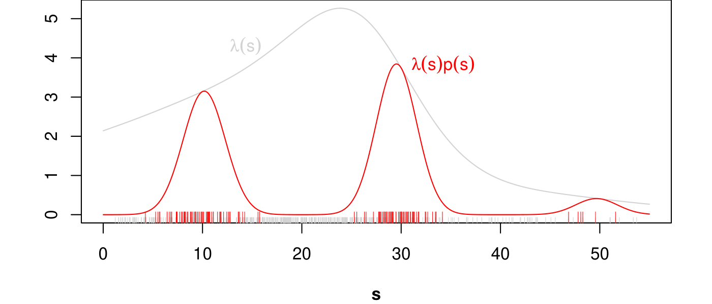{fig-align="center"}

Observations are from a thinned Poisson process with intensity $\lambda(s) \color{red}{p(s)}$

## Detection Function {.smaller auto-animate="true" background-color="#FFFFFF"}

::: {style="height: 50px;"}
:::

-   Standard distance sampling approaches specify $g(s)$ as a function that declines with increasing distance
    -   horizontal distance to the observer for *point transects*
    -   perpendicular distance to the transect line for *line transects*

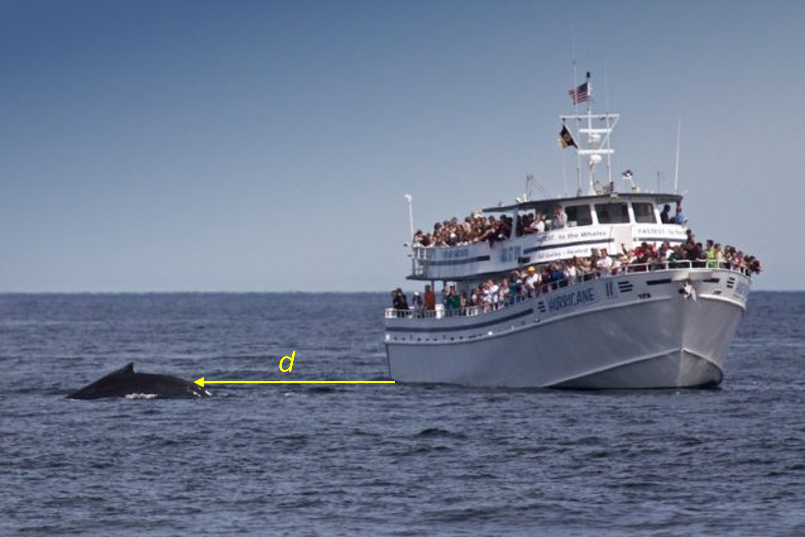{fig-align="center" width="398"}

## Detection Function {.smaller auto-animate="true" background-color="#FFFFFF"}

::: {style="height: 50px;"}
:::

-   Standard distance sampling approaches specify $g(s)$ as a function that declines with increasing distance
    -   horizontal distance to the observer for *point transects*
    -   [perpendicular distance to the transect line for *line transects*]{style="color:red;"}

{fig-align="center" width="448"}

## Detection Function {.smaller auto-animate="true" background-color="#FFFFFF"}

::: {style="height: 50px;"}
:::

-   Standard distance sampling approaches specify $g(s)$ as a function that declines with increasing distance
    -   horizontal distance to the observer for *point transects*
    -   perpendicular distance to the transect line for *line transects*
-   The thinning probability function is specified as a parametric family of functions.

::::: columns
::: {.column width="40%"}
**Half-normal**: $g(\mathbf{s}|\sigma) = \exp(-0.5 (d(\mathbf{s})/\sigma)^2)$

**Hazard-rate** :$g(\mathbf{s}|\sigma) = 1 - \exp(-(d(\mathbf{s})/\sigma)^{-1})$
:::

::: {.column width="60%"}
```{r}
#| echo: false
#| message: false
#| warning: false
#| fig-align: center
#| fig-width: 4.6
#| fig-height: 3.5


library(ggplot2)
# Parameters
sigma <- 50
b <- 2
distances <- seq(0, 150, length.out = 200)

# Create data
df <- data.frame(
  distance = rep(distances, 2),
  probability = c(exp(-distances^2 / (2 * sigma^2)),
                  1 - exp(-(distances/sigma)^(-b))),
  type = rep(c("Half-normal", "Hazard-rate"), each = 200)
)

# Simple plot with linetypes
ggplot(df, aes(x = distance, y = probability, color = type, linetype = type)) +
  geom_line(size = 1) +
  labs(
    x = "Distance",
    y = "Detection Probability",
    color = "Type",
    linetype = "Type"
  ) +
  scale_color_manual(values = c("#2E86AB", "#E76F51")) +
  scale_linetype_manual(values = c("solid", "dashed")) +
  theme_minimal()
```
:::
:::::

## Detection Function {.smaller auto-animate="true" background-color="#FFFFFF"}

::: {style="height: 50px;"}
:::

-   Standard distance sampling approaches specify $g(s)$ as a function that declines with increasing distance
    -   horizontal distance to the observer for *point transects*
    -   perpendicular distance to the transect line for *line transects*
-   The thinning probability function is specified as a parametric family of functions.
-   The thinned-LGCP likelihood is given by:

$$
\pi(\mathbf{s_1},\ldots,\mathbf{s_m}) = \exp\left( |\Omega| - \int_{\mathbf{s}\in\Omega}\lambda(s)g(s)\text{d}s \right) \prod_{i=1}^m \lambda(\mathbf{s}_i)g(\mathbf{s}_i)
$$

-   To make $g(s)$ and $\lambda(s)$ identifiable, we assume intensity is constant with respect to distance from the observer.

    -   In practice this means we assume animals are uniformly distributed with respect to distance from the line

## Putting all the pieces together {.smaller auto-animate="true" background-color="#FFFFFF"}

::::: columns
::: {.column width="40%"}
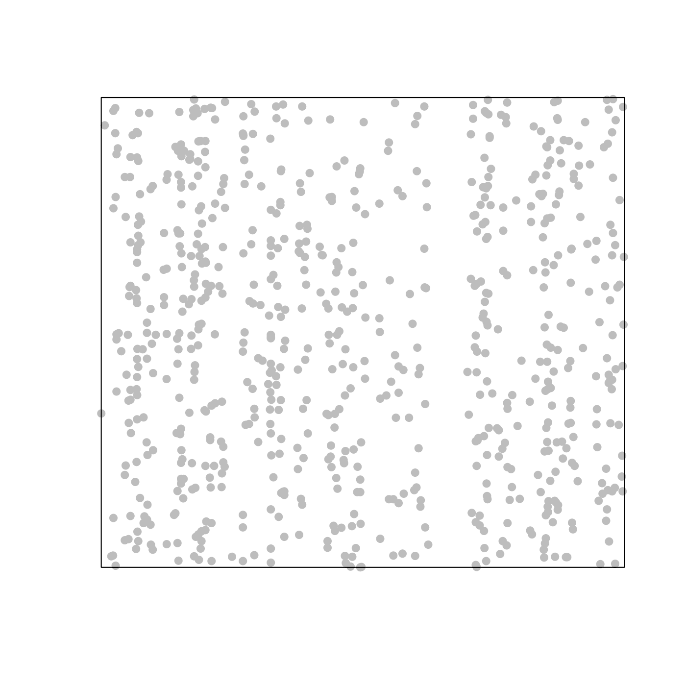{fig-align="center"}
:::

::: {.column width="60%"}
-   The true point pattern $Y = \mathbf{s}_1,\ldots,\mathbf{s}_n$ are a realization of a Point process with intensity $\lambda(s)$
:::
:::::

## Putting all the pieces together {.smaller auto-animate="true" background-color="#FFFFFF"}

::::: columns
::: {.column width="40%"}
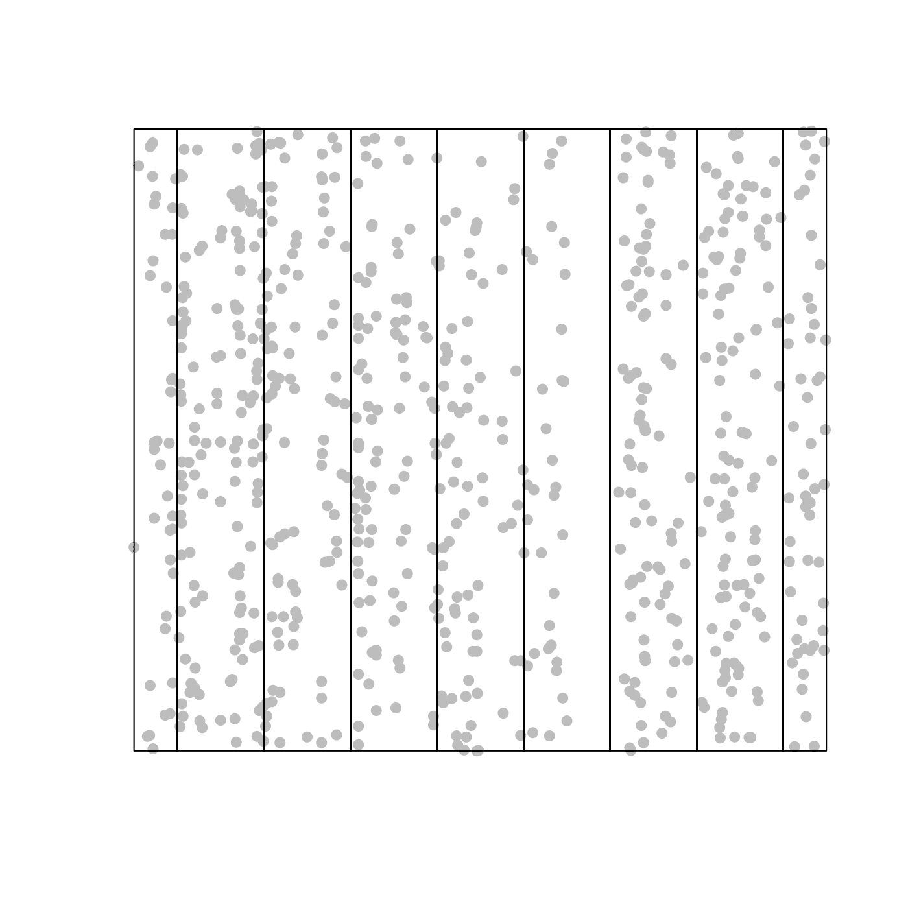{fig-align="center"}
:::

::: {.column width="60%"}
-   The true point pattern $Y = \mathbf{s}_1,\ldots,\mathbf{s}_n$ are a realization of a Point process with intensity $\lambda(s)$
-   We design a sampling survey to collect the data along transects
:::
:::::

## Putting all the pieces together {.smaller auto-animate="true" background-color="#FFFFFF"}

::::: columns
::: {.column width="40%"}
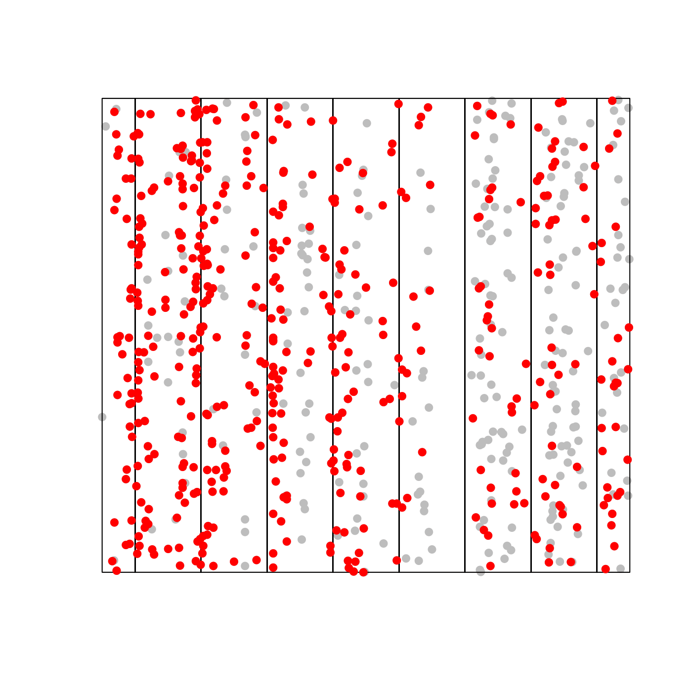{fig-align="center"}
:::

::: {.column width="60%"}
-   The true point pattern $Y = \mathbf{s}_1,\ldots,\mathbf{s}_n$ are a realization of a Point process with intensity $\lambda(s)$
-   We design a sampling survey to collect the data along transects
-   [detected points]{style="color:grey;"} are generated from the thinned PP with intensity $\color{red}{\tilde{\lambda}(s)}= \lambda(s)\color{red}{g(d(s))}$
    -   The **log intensity** $\log \color{red}{\tilde{\lambda}(s)} = \overbrace{\log \lambda (s)}^{\mathbf{x}'\beta + \xi(s)} + \overbrace{\log \color{red}{g(d(s))}}^{-0.5~d(\mathbf{s})^2\sigma^{-2}}$
:::
:::::

## Putting all the pieces together {.smaller auto-animate="true" background-color="#FFFFFF"}

::::: columns
::: {.column width="40%"}
{fig-align="center"}
:::

::: {.column width="60%"}
-   The true point pattern $Y = \mathbf{s}_1,\ldots,\mathbf{s}_n$ are a realization of a Point process with intensity $\lambda(s)$
-   We design a sampling survey to collect the data along transects
-   [detected points]{style="color:grey;"} are generated from the thinned PP with intensity $\color{red}{\tilde{\lambda}(s)}= \lambda(s)\color{red}{g(d(s))}$
    -   The **log intensity** $\log \color{red}{\tilde{\lambda}(s)} = \overbrace{\log \lambda (s)}^{\mathbf{x}'\beta + \xi(s)} + \overbrace{\log \color{red}{g(d(s))}}^{-0.5~d(\mathbf{s})^2\sigma^{-2}}$
    -   The **encounter rate**, i.e. the number of observed animals within a distance $W$ follows $m \sim \text{Poisson} \left(\int_0^W \tilde{\lambda}(d)\text{d}d\right)$
:::
:::::

-   The pdf of detected *distances* is $\pi(d_1,\ldots,d_m|m) \propto \prod_{i=1}^m\dfrac{\tilde{\lambda}(d_i)}{\int_0^W \tilde{\lambda}(d)\text{d}d}$

## Putting all the pieces together {.smaller auto-animate="true" background-color="#FFFFFF"}

::::: columns
::: {.column width="40%"}
{fig-align="center"}
:::

::: {.column width="60%"}
-   The true point pattern $Y = \mathbf{s}_1,\ldots,\mathbf{s}_n$ are a realization of a Point process with intensity $\lambda(s)$
-   We design a sampling survey to collect the data along transects
-   [detected points]{style="color:grey;"} are generated from the thinned PP with intensity $\color{red}{\tilde{\lambda}(s)}= \lambda(s)\color{red}{g(d(s))}$
    -   The **log intensity** $\log \color{red}{\tilde{\lambda}(s)} = \overbrace{\log \lambda (s)}^{\mathbf{x}'\beta + \xi(s)} + \overbrace{\log \color{red}{g(d(s))}}^{-0.5~d(\mathbf{s})^2\sigma^{-2}}$
    -   The **encounter rate**, i.e. the number of observed animals within a distance $W$ follows $m \sim \text{Poisson} \left(\int_0^W \tilde{\lambda}(d)\text{d}d\right)$
:::
:::::

-   The pdf of detected *distances* is $\pi(d_1,\ldots,d_m|m) \propto \prod_{i=1}^m\dfrac{ g(d_i)}{\int_o^W g(d) \text{d}d}$ if $\color{red}{\tilde{\lambda}(d_i)} = \lambda \color{red}{g(d_i)}$

## An approximation: Strips as lines

-   If the strips width ($2W$) is narrow compared to study region ($\Omega$) we can treat them as lines.

    -   We need to adjust the intensity at a *point* $\mathbf{s}$ on the line to take account of the actual width of the strip

    -   Adjust the thinning probability to account for having collapsed all points onto the line.

## An approximation: Strips as lines {.smaller}

The intensity at a *point* $\mathbf{s}$ on the line becomes $2W\lambda(s)$ instead of $\lambda(s)$.

-   Let $\pi(d)$ be the probability that the point is at a distance $d$ from the line.

-   Let $p(d)$ be the probability that is detected given it is at $d$.

Then, the thinning probability becomes $\pi(d)\times p(d)$, assuming the points are uniformly distributed within the strip then $\pi(d) = 1/W$ (the density of distances is assumed to be constant on the interval $[0,W]$).

This updates our thinning intensity to

$$
\log \tilde{\lambda}(s) = \underbrace{\mathbf{x}'\beta + \xi(s)}_{\log \lambda(s)} + \log p(d) + \log \times(2/2W)
$$

-   Typically $p(d)$ is a non-linear function, that is where `inlabru` can help via a **Fixed point iteration scheme** (further details available in this [vignette](https://cran.r-project.org/web/packages/inlabru/vignettes/method.html))

::: notes
$$
\mathbb{E}[N_{\text{det}}] = 2W \lambda(s) \times \frac{1}{W} \int_0^W p(r)  dr = 2\lambda(s) \int_0^W p(r)  dr
$$
:::

# Example

## Example: Dolphins in the Gulf of Mexico {.smaller}

In the next example, we will explore data from a combination of several NOAA shipboard surveys conducted on pan-tropical spotted dolphins in the Gulf of Mexico.

-   A total of 47 observations of groups of dolphins were detected. The group size was recorded, as well as the Beaufort sea state at the time of the observation.

-   Transect width is 16 km, i.e. maximal detection distance 8 km (transect half-width 8 km).

```{r}
#| echo: false
#| message: false
#| eval: true
#| out-width: 100%

library(mapview)
mapviewOptions(basemaps = c( "OpenStreetMap.DE"))
mexdolphin <- mexdolphin_sf

mapview(mexdolphin$points,zcol="size")+
  mapview(mexdolphin$samplers)+
 mapview(mexdolphin$ppoly )

mesh = fm_mesh_2d(boundary = mexdolphin$ppoly,
                    max.edge = c(30, 150),
                    cutoff = 15,
                    crs = fm_crs(mexdolphin$points))

```

## Step 1: Define the SPDE representation: The mesh {.smaller auto-animate="true" background-color="#FFFFFF"}

First, we need to create the mesh used to approximate the random field. We can either:

1.  Create a nonconvex extension of the points using the `fm_mesh_2d` and `fm_nonconvex_hull` functions from the `fmesher` package:

```{r}
#| message: false
#| warning: false
library(fmesher)

boundary0 = fm_nonconvex_hull(mexdolphin$points,convex = -0.1)

mesh_0 = fm_mesh_2d(boundary = boundary0,
                          max.edge = c(30, 150), # The largest allowed triangle edge length.
                          cutoff = 15,
                          crs = fm_crs(mexdolphin$points))
```

::::: columns
::: {.column width="60%"}
```{r}
#| echo: false
  ggplot() + gg(mesh_0) +geom_sf(data=mexdolphin$points)
```
:::

::: {.column width="40%"}
-   `max.edge` for maximum triangle edge lengths
-   `cutoff` to avoid overly small triangles in clustered areas
:::
:::::

## Step 1: Define the SPDE representation: The mesh {.smaller auto-animate="true" background-color="#FFFFFF"}

First, we need to create the mesh used to approximate the random field. We can either:

2.  Use a pre-defined `sf` boundary and specify this directly onto the mesh construction via the `fm_mesh_2d` function

```{r}
#| message: false
#| warning: false
library(fmesher)


mesh_1 = fm_mesh_2d(boundary = mexdolphin$ppoly,
                    max.edge = c(30, 150),
                    cutoff = 15,
                    crs = fm_crs(mexdolphin$points))

```

::::: columns
::: {.column width="60%"}
```{r}
#| echo: false
  ggplot() + gg(mesh_1) +geom_sf(data=mexdolphin$points)
```
:::

::: {.column width="40%"}
-   `max.edge` for maximum triangle edge lengths
-   `cutoff` to avoid overly small triangles in clustered areas
:::
:::::

## Step 2: Define the Detection function {.smaller background-color="#FFFFFF"}

We start by plotting the distances and histogram of frequencies in distance intervals.

```{r}
#| echo: false
#| fig-align: center
#| fig-height: 3
#| fig-width: 5
W <- 8
ggplot(mexdolphin$points) +
  geom_histogram(aes(x = distance),
    breaks = seq(0, W, length.out = 9),
    boundary = 0, fill = NA, color = "black"
  ) +
  geom_point(aes(x = distance), y = 0, pch = "|", cex = 4)

```

Then, we need to define a half-normal detection probability function. This must take distance as its first argument and the linear predictor of the sigma parameter as its second:

```{r}
# define detection function
hn <- function(distance, sigma) {
  exp(-0.5 * (distance / sigma)^2)
}
```

## Example: Dolphins in the Gulf of Mexico {.smaller background-color="#FFFFFF"}

::::: columns
::: {.column width="60%"}
**The LGCP Model**

$$
\begin{aligned}
p(\mathbf{y} | \lambda)  & \propto \exp \left( -\int_\Omega \lambda(\mathbf{s}) p(\mathbf{s}) \mathrm{d}\mathbf{s} \right) \prod_{i=1}^n \lambda(\mathbf{s}_i) p(\mathbf{s}_i)) \\
\eta(s) &  = \color{#FF6B6B}{\boxed{\beta_0}} + \color{#FF6B6B}{\boxed{ \omega(s)}} + \color{#FF6B6B}{\boxed{ \log p(s)}} \\
\end{aligned}
$$

**The code**

```{r}
#| echo: true
#| eval: false
#| warning: false
#| message: false
#| code-line-numbers: "1-7"

# define model component
cmp = ~ Intercept(1) + 
  space(main = geometry, model = spde_model) +
  sigma(1,
    prec.linear = 1,
    marginal = bru_mapper_marginal(qexp, pexp, dexp, rate = 1 / 8)
  ) 

# define model predictor
eta  = geometry + distance ~ space +
  log(hn(distance, sigma)) +
  Intercept + log(2)

# build the observation model
lik = bru_obs("cp",
              formula = eta,
              data = mexdolphin$points,
              ips = ips)

# fit the model
fit = bru(cmp, lik)
```
:::

::: {.column width="40%"}
The **integration scheme**

```{r}
#| echo: true


# build integration scheme
distance_domain <-  fm_mesh_1d(seq(0, 8,
                              length.out = 30))
ips = fm_int(list(geometry = mesh,
                  distance = distance_domain),
             samplers = mexdolphin$samplers)
```

```{r}
#| echo: false
#| fig-width: 5
#| fig-height: 4

ggplot()  + geom_sf(data = ips, aes(color = weight),size=0.5) + 
   scale_color_scico(palette = "roma") + gg(mesh) 

```
:::
:::::

::: notes
The samplers in this dataset are lines, not polygons, so we need to tell `inlabru` about the strip half-width, W, which in the case of these data is 8.

To control the prior distribution for the $\sigma$ parameter, we use a transformation mapper that converts a latent variable into an exponentially distributed variable with expectation 8

The `marginal` argument in the sigma component specifies the transformation function taking N(0,1) to Exponential(1/8).
:::

## Example: Dolphins in the Gulf of Mexico {.smaller background-color="#FFFFFF"}

::::: columns
::: {.column width="60%"}
**The LGCP Model**

$$
\begin{aligned}
p(\mathbf{y} | \lambda)  & \propto \exp \left( -\int_\Omega \lambda(\mathbf{s}) p(\mathbf{s}) \mathrm{d}\mathbf{s} \right) \prod_{i=1}^n \lambda(\mathbf{s}_i) p(\mathbf{s}_i)) \\
\color{#FF6B6B}{\boxed{\eta(s)}} &  = \color{#FF6B6B}{\boxed{\beta_0 +  \omega(s) +  \log p(s)}}\\
\end{aligned}
$$

**The code**

```{r}
#| echo: true
#| eval: false
#| warning: false
#| message: false
#| code-line-numbers: "9-12"

# define model component
cmp = ~ Intercept(1) + 
  space(main = geometry, model = spde_model) +
  sigma(1,
    prec.linear = 1,
    marginal = bru_mapper_marginal(qexp, pexp, dexp, rate = 1 / 8)
  ) 

# define model predictor
eta  = geometry + distance ~ space +
  log(hn(distance, sigma)) +
  Intercept + log(2)

# build the observation model
lik = bru_obs("cp",
              formula = eta,
              data = mexdolphin$points,
              ips = ips)

# fit the model
fit = bru(cmp, lik)
```
:::

::: {.column width="40%"}
The **integration scheme**

```{r}
#| echo: true

# build integration scheme
distance_domain <-  fm_mesh_1d(seq(0, 8,
                              length.out = 30))
ips = fm_int(list(geometry = mesh,
                  distance = distance_domain),
             samplers = mexdolphin$samplers)
```

```{r}
#| echo: false
#| fig-width: 5
#| fig-height: 4

ggplot()  + geom_sf(data = ips, aes(color = weight),size=0.5) + 
   scale_color_scico(palette = "roma") + gg(mesh) 

```
:::
:::::

::: notes
we need an offset due to the unknown direction of the detections
:::

## Example: Dolphins in the Gulf of Mexico {.smaller background-color="#FFFFFF"}

::::: columns
::: {.column width="60%"}
**The LGCP Model**

$$
\begin{aligned}
\color{#FF6B6B}{\boxed{p(\mathbf{y} | \lambda)}} & \propto \exp \left( -\int_\Omega \lambda(\mathbf{s}) p(\mathbf{s}) \mathrm{d}\mathbf{s} \right) \prod_{i=1}^n \lambda(\mathbf{s}_i) p(\mathbf{s}_i)) \\
\eta(s) &  = \beta_0 +  \omega(s) +  \log p(s) \\
\end{aligned}
$$

**The code**

```{r}
#| echo: true
#| eval: false
#| warning: false
#| message: false
#| code-line-numbers: "13-18"

# define model component
cmp = ~ Intercept(1) + 
  space(main = geometry, model = spde_model) +
  sigma(1,
    prec.linear = 1,
    marginal = bru_mapper_marginal(qexp, pexp, dexp, rate = 1 / 8)
  ) 

# define model predictor
eta  = geometry + distance ~ space +
  log(hn(distance, sigma)) +
  Intercept + log(2)

# build the observation model
lik = bru_obs("cp",
              formula = eta,
              data = mexdolphin$points,
              ips = ips)

# fit the model
fit = bru(cmp, lik)
```
:::

::: {.column width="40%"}
The **integration scheme**

```{r}
#| echo: true

# build integration scheme
distance_domain <-  fm_mesh_1d(seq(0, 8,
                              length.out = 30))
ips = fm_int(list(geometry = mesh,
                  distance = distance_domain),
             samplers = mexdolphin$samplers)
```

```{r}
#| echo: false
#| fig-width: 5
#| fig-height: 4

ggplot()  + geom_sf(data = ips, aes(color = weight),size=0.5) + 
   scale_color_scico(palette = "roma") + gg(mesh) 

```
:::
:::::

## Example: Dolphins in the Gulf of Mexico {.smaller background-color="#FFFFFF"}

::::: columns
::: {.column width="60%"}
**The LGCP Model**

$$
\begin{aligned}
\color{#FF6B6B}{\boxed{p(\mathbf{y} | \lambda)}} & \propto \exp \left( -\int_\Omega \lambda(\mathbf{s}) p(\mathbf{s}) \mathrm{d}\mathbf{s} \right) \prod_{i=1}^n \lambda(\mathbf{s}_i) p(\mathbf{s}_i)) \\
\eta(s) &  = \beta_0 +  \omega(s) +  \log p(s) \\
\end{aligned}
$$

**The code**

```{r}
#| echo: true
#| eval: false
#| warning: false
#| message: false
#| code-line-numbers: "20-21"

# define model component
cmp = ~ Intercept(1) + 
  space(main = geometry, model = spde_model) +
  sigma(1,
    prec.linear = 1,
    marginal = bru_mapper_marginal(qexp, pexp, dexp, rate = 1 / 8)
  ) 

# define model predictor
eta  = geometry + distance ~ space +
  log(hn(distance, sigma)) +
  Intercept + log(2)

# build the observation model
lik = bru_obs("cp",
              formula = eta,
              data = mexdolphin$points,
              ips = ips)

# fit the model
fit = bru(cmp, lik)
```
:::

::: {.column width="40%"}
The **integration scheme**

```{r}
#| echo: true

# build integration scheme
distance_domain <-  fm_mesh_1d(seq(0, 8,
                              length.out = 30))
ips = fm_int(list(geometry = mesh,
                  distance = distance_domain),
             samplers = mexdolphin$samplers)
```

```{r}
#| echo: false
#| fig-width: 5
#| fig-height: 4

ggplot()  + geom_sf(data = ips, aes(color = weight),size=0.5) + 
   scale_color_scico(palette = "roma") + gg(mesh) 

```
:::
:::::

# Results

## Results: posterior summaries {.smaller background-color="#FFFFFF"}

```{r}
#| echo: false
spde_model =  inla.spde2.pcmatern(
  mexdolphin$mesh,
  prior.sigma = c(2, 0.1),
  prior.range = c(50, 0.1)
)


# define model component
cmp = ~ Intercept(1) + 
  space(main = geometry, model = spde_model) +
  sigma(1,
    prec.linear = 1,
    marginal = bru_mapper_marginal(qexp, pexp, dexp, rate = 1 / 8)
  ) 

# define model predictor
eta  = geometry + distance ~ space +
  log(hn(distance, sigma)) +
  Intercept + log(2)

# build the observation model
lik = bru_obs("cp",
              formula = eta,
              data = mexdolphin$points,
              ips = ips)

# fit the model
fit = bru(cmp, lik)
```

::::: columns
::: {.column width="40%"}
We can use the `fit$summary.fixed` and `summary.hyperpar` to obtain posterior summaries of the model parameters.

```{r}
#| echo: false
rbind(fit$summary.fixed[,c(1,3,5)],
      fit$summary.hyperpar[,c(1,3,5)]) %>% gt(rownames_to_stub = TRUE) %>% fmt_number(decimals=2)

```
:::

::: {.column width="60%"}
The `spde.posterior` allows us to plot the posterior density of the Matérn field parameters

```{r}
spde.posterior(fit, "space", what = "range") %>% plot()
```
:::
:::::

## Results: posterior summaries {.smaller background-color="#FFFFFF"}

```{r}
#| echo: false

# define model component
cmp = ~ Intercept(1) + 
  space(main = geometry, model = spde_model) +
  sigma(1,
    prec.linear = 1,
    marginal = bru_mapper_marginal(qexp, pexp, dexp, rate = 1 / 8)
  ) 

# define model predictor
eta  = geometry + distance ~ space +
  log(hn(distance, sigma)) +
  Intercept + log(2)

# build the observation model
lik = bru_obs("cp",
              formula = eta,
              data = mexdolphin$points,
              ips = ips)

# fit the model
fit = bru(cmp, lik)
```

::::: columns
::: {.column width="40%"}
We can use the `fit$summary.fixed` and `summary.hyperpar` to obtain posterior summaries of the model parameters.

```{r}
#| echo: false
rbind(fit$summary.fixed[,c(1,3,5)],
      fit$summary.hyperpar[,c(1,3,5)]) %>% gt(rownames_to_stub = TRUE) %>% fmt_number(decimals=2)

```
:::

::: {.column width="60%"}
The `spde.posterior` allows us to plot the posterior density of the Matérn field parameters

```{r}
spde.posterior(fit, "space", what = "log.variance") %>% plot()
```
:::
:::::

## Results: predicted densities {.smaller background-color="#FFFFFF"}

::::: columns
::: {.column width="40%"}
To map the spatial intensity we first need to define a grid of points where we want to predict.

-   We do this using the function `fm_pixel()` which creates a regular grid of points covering the mesh
-   Then, we use the `predict` function which takes as input
    -   the fitted model (`fit`)
    -   the prediction points (`pxl`)
    -   the model components we want to predict (e.g., $e^{\beta_0 + \xi(s)}$)
:::

::: {.column width="60%"}
```{r}
#| message: false
#| warning: false
library(patchwork)
pxl <- fm_pixels(mesh, dims = c(200, 100), mask = mexdolphin$ppoly)
pr.int <- predict(fit, pxl, ~ data.frame(spatial = space,
                                      loglambda = Intercept + space,
                                      lambda = exp(Intercept + space)))
```

```{r}
#| eval: false
ggplot() +
  gg(pr.int$spatial, geom = "tile")
```

```{r}
#| echo: false
ggplot() +
  gg(pr.int$spatial, geom = "tile") +
  scale_fill_scico(palette = "roma")+
ggplot() +
  gg(pr.int$loglambda, geom = "tile") +
  scale_fill_scico(palette="imola",name=expression(log(lambda)))+
ggplot() +
gg(pr.int$loglambda, geom = "tile",aes(fill = sd)) +
  scale_fill_scico(name=expression(sd~log(lambda)))+
ggplot() +
  gg(pr.int$lambda, geom = "tile") +
  scale_fill_scico(name=expression(lambda))+ plot_layout(ncol=1)+ 
  plot_layout(ncol=2)
```
:::
:::::

## Results: predicted densities {.smaller background-color="#FFFFFF"}

::::: columns
::: {.column width="60%"}
We can also `predict` the detection function:

```{r}
#| echo: true
distdf <- data.frame(distance = seq(0, 8, length.out = 100))
dfun <- predict(fit, distdf, ~ hn(distance, sigma))
```
:::

::: {.column width="40%"}
:::

```{r}
plot(dfun)
```
:::::

## Results: predicted expected counts {.smaller background-color="#FFFFFF"}

We can look at the posterior for the mean expected number of dolphins. Remember, the number of dolphins over the whole domain $\Omega$ is $$
N(\Omega)\sim\text{Poisson}(E_{\Omega}), \text{ with } E_{\Omega} = \int_{\Omega}\lambda(s)ds
$$ so the expected mean number of dolphins is 
$$
E_{\Omega} = \int_{\Omega}\lambda(s)ds = \int_{\Omega}\exp\{\beta_0+\omega(s)\}ds
$$

```{r}
#| echo: true
predpts <- fm_int(mexdolphin$mesh, mexdolphin$ppoly)
Lambda <- generate(fit, predpts, ~ sum(weight * exp(space + Intercept)),
                   n.samples = 3000)

```

Estimate:

```{r}
m = mean(Lambda[1,])
data.frame(ll = Lambda[1,]) %>% ggplot() + geom_density(aes(x = ll, y = after_stat(density))) +
  geom_vline(aes(xintercept = mean(ll), color = "Posterior Mean")) + theme(legend.title = element_blank()) +
  ggtitle("Mean expected number of dolphins", subtitle = "Posterior distribution")

```

## Results: predicted expected counts {.smaller background-color="#FFFFFF"}

If want to predict the expected counts We can also get Monte Carlo samples for the expected number of dolphins as follows:

::::: columns
::: {.column width="60%"}
```{r}
Ns <- seq(50, 650, by = 1)

Nests = predict(fit, predpts,
             ~{lambda = sum(weight * exp(space + Intercept))
               Ns <- Ns
               list(dens = dpois(Ns, lambda))
             },n.samples = 3000)

Nests_gen = generate(fit, predpts,
             ~{lambda = sum(weight * exp(space + Intercept))
               Ns <- Ns
               list(dens = dpois(Ns, lambda))
             },n.samples = 10)

dim(sapply(Nests_gen, function(x)x$dens))
NN_gen = data.frame(Ns = Ns, 
                    sapply(Nests_gen, function(x)x$dens)) %>%
  pivot_longer(-Ns)

data.frame(ll = Lambda[1,]) %>% ggplot() + geom_density(aes(x = ll, y = after_stat(density))) +
  geom_vline(aes(xintercept = mean(ll), color = "Posterior Mean")) + theme(legend.title = element_blank()) +
  ggtitle("Mean expected number of dolphins", subtitle = "Posterior distribution")+ geom_line(data = Nests$dens %>% mutate(N = Ns), aes(Ns, mean))


ggplot() + geom_line(data = Nests$dens %>% mutate(N = Ns), aes(Ns, mean))  +
  geom_ribbon(data = Nests$dens %>% mutate(N = Ns), aes(Ns, ymin = q0.025, ymax = q0.975), alpha = 0.5) +
  geom_line(data = NN_gen, aes(Ns, value, group = name))


```
:::

::: {.column width="40%"}
```{r}
#| echo: false


```
:::
:::::


# References {.smaller data-title-offset="true"}

[@de2025spatio @laxton2023balancing @palmi2025bayesian @simpson2016going ]{style="display:none"}

::: {#refs}
:::

```{=html}
<script>
document.querySelectorAll('#refs [id^="ref-"]').forEach(function(entry) {
  var key = entry.id;                       // e.g. "ref-besag1991"
  var a = document.createElement('a');
  a.href = '../references.html#' + key;
  a.target = '_blank';
  a.style.textDecoration = 'none';
  a.style.color = 'inherit';
  while (entry.firstChild) a.appendChild(entry.firstChild);
  entry.appendChild(a);
});
</script>
```


